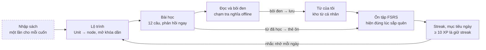

# English101 — Product Requirements Document (PRD)

> Phiên bản: 1.1 · Ngày: 2026-09-28 · Trạng thái: bản nháp chờ chủ dự án chốt các câu hỏi ở mục 11
> Bản chia sẻ/bình luận được: Claude Doc "English101 PRD" (https://claude.ai/code/artifact/37ea600d-49e0-445c-a89c-5c47a7a9e41c)
> Tài liệu liên quan: [UI/UX Flow](UI-UX-FLOWS.md) · [Kế hoạch Sprint](SPRINT-PLAN.md) · [Kiến trúc](../spec/ARCHITECTURE.md) · [Quy chuẩn code](../spec/CODING-STANDARDS.md)

English101 là app học tiếng Anh mã nguồn mở, chạy offline, biến sách người dùng sở hữu thành lộ trình học kiểu Duolingo. Từ nào người học bôi đen khi đọc sẽ vào kho từ cá nhân và được ôn bằng FSRS. Beta v0.1 (Android trước) nhắm ngày **2027-03-12**, sau 11 sprint 2 tuần bắt đầu **2026-10-05**.

---

## 1. Bối cảnh & mục tiêu

Chưa sản phẩm nào gộp đủ: lộ trình kiểu Duolingo, học theo chính cuốn sách người dùng sở hữu, bôi đen từ vào kho từ cá nhân và ôn FSRS offline. English101 lấp khoảng trống này bằng mô hình "tự mang sách" (bring-your-own-book).

### Vấn đề

- Người tự học có sách tốt (PDF, EPUB) nhưng thiếu lộ trình chia nhỏ và cơ chế giữ nhịp hằng ngày.
- Highlight và đọc lại là kỹ thuật "low utility" (Dunlosky 2013); việc nhớ thật chỉ đến khi có nhớ lại chủ động và lặp lại ngắt quãng.
- Duolingo giỏi tạo thói quen nhưng chỉ dùng giáo trình riêng. LingQ, Readlang cho lưu từ khi đọc nhưng không có lộ trình dạng game.
- App English Grammar in Use của Cambridge đã bị gỡ khỏi Google Play (10/2022); eBook Cambridge One không có streak hay SRS.

### Tầm nhìn

Mọi cuốn sách tiếng Anh bạn sở hữu đều thành một khóa học kiểu Duolingo, 10 phút mỗi ngày, và mọi từ bạn gặp đều được nhớ lâu.

### Mục tiêu v0.1

| # | Mục tiêu | Chỉ số đo | Ngưỡng đạt |
| --- | --- | --- | --- |
| G1 | Từ file sách đến bài học đầu tiên thật nhanh | Thời gian từ lúc chọn file đến lúc bắt đầu bài 1, sách 300 trang | ≤ 3 phút (trung vị) |
| G2 | Hình thành thói quen học mỗi ngày | % ngày kiếm ≥ 10 XP trong 66 ngày đầu của chủ dự án | ≥ 80% |
| G3 | Nhớ từ bằng ôn chủ động | Tỷ lệ nhớ thực tế trong phiên ôn FSRS | 85–92% |
| G4 | Nhập sách đáng tin cậy | % sách sinh được lộ trình dùng ngay, không sửa tay | EPUB/TXT/MD ≥ 90%; PDF có lớp chữ ≥ 75% |
| G5 | Cộng đồng đóng góp được | Thời gian để contributor mới clone, chạy app và test | ≤ 30 phút |

### Chỉ số theo dõi

Mọi chỉ số tính trên máy người dùng; telemetry chỉ có từ v0.2 và mặc định tắt.

| Nhóm | Chỉ số | Mục tiêu nhóm beta |
| --- | --- | --- |
| Kích hoạt | % người cài mới hoàn thành bài đầu tiên trong ngày 1 | ≥ 60% |
| Giữ chân | D1 / D7 / D30 (khảo sát tester, telemetry opt-in từ v0.2) | ≥ 40% / ≥ 20% / ≥ 10% |
| Thói quen | Độ dài streak trung vị sau 30 ngày | ≥ 10 ngày |
| Học tập | Số từ "thành thạo" mới mỗi tuần (mọi thẻ có stability ≥ 21 ngày) | ≥ 15 từ |
| Chất lượng | Tỷ lệ phiên không crash | ≥ 99,5% |

### Phi mục tiêu v0.1

- Không tài khoản, không đồng bộ đám mây, không bảng xếp hạng.
- Không phân phối nội dung sách có bản quyền; repo chỉ chứa sách mẫu thuộc phạm vi công cộng.
- Không tính năng AI; AI vào v0.2, tùy chọn, người dùng tự mang API key.
- Không chấm phát âm, không bản web/desktop, không quảng cáo, không thu phí.

---

## 2. Người dùng mục tiêu

Người dùng chính là người Việt tự học tiếng Anh trình độ A1–B2, có sẵn sách riêng, chỉ học được 10–15 phút mỗi ngày trên điện thoại. Người dùng thứ hai là lập trình viên muốn đóng góp cho dự án.

| Persona | Hồ sơ | Nỗi đau | Job-to-be-done | Tính năng quyết định |
| --- | --- | --- | --- | --- |
| Minh, 27 tuổi, người đi làm "mất gốc" (A2) | Có bộ Grammar in Use bản PDF đã mua; học buổi sáng sau cà phê; Android tầm trung | Mua sách rồi bỏ dở sau 2 tuần; học xong vài hôm là quên | Khi có sách hay mà thiếu kỷ luật, tôi muốn app chia sách thành bài ngắn và nhắc tôi mỗi ngày, để học hết cuốn sách | Lộ trình tự sinh, streak, nhắc nhở, mục tiêu 10–20 XP |
| Lan, 20 tuổi, sinh viên luyện IELTS (B1) | Đọc nhiều EPUB, PDF truyện và sách luyện thi; dùng cả điện thoại và tablet | Chép từ mới vào sổ rồi không ôn; thấy Anki quá thô | Khi gặp từ mới lúc đọc, tôi muốn lưu nhanh kèm câu ngữ cảnh và được nhắc ôn đúng lúc, để dùng được từ khi viết và nói | Chạm tra từ offline, bôi đen lưu cụm từ, thẻ điền từ và nghe, FSRS |
| Tuấn, 30 tuổi, lập trình viên Flutter (contributor) | Đóng góp mã nguồn mở buổi tối, 3–5 giờ mỗi tuần | Repo thiếu tài liệu, kiến trúc rối, PR bị treo lâu | Khi muốn thêm parser DOCX hay một dạng bài mới, tôi muốn biết chạm vào đâu và cần đạt chuẩn gì, để PR được merge trong tuần | Điểm mở rộng rõ, CONTRIBUTING, good first issue, CI dưới 10 phút |

Ngữ cảnh dùng: phiên ngắn 5–15 phút, thường offline (xe buýt, trước khi ngủ), một tay cầm máy. Không nhắm tới trẻ em dưới 13 tuổi và người cần giáo viên chấm bài.

---

## 3. Vòng lặp học cốt lõi

Vòng lặp có sáu bước, lặp lại mỗi ngày; nhập sách chỉ làm một lần cho mỗi cuốn.

Từ học trong bài và từ bôi đen khi đọc cùng vào một hàng ôn FSRS. Mọi hoạt động đều cộng XP để giữ streak, và nhắc nhở kéo người học quay lại lộ trình.

Nguyên tắc sư phạm đi kèm vòng lặp:

- Nhớ lại trước, đọc sau: mỗi bài mở đầu bằng tối đa 2 thẻ ôn đến hạn (retrieval practice).
- Độ khó tăng dần trong mỗi node: nhận diện → nhớ lại → tự viết ra (desirable difficulties).
- Bôi đen chỉ là thu thập; từ chỉ được tính "thành thạo" khi qua ôn chủ động.
- Mục tiêu tối thiểu rất nhỏ (10 XP, khoảng 1 bài) để giữ streak, theo Tiny Habits.
- Từ mới từ bôi đen bị giới hạn 10 từ/ngày để người học không bị ngợp.

---

## 4. Phạm vi theo bản phát hành

v0.1 giao trọn vòng lặp cốt lõi, chạy offline trên Android. AI vào v0.2; tài khoản, đồng bộ và yếu tố xã hội vào v1.0. Ký hiệu: (M) Must, (S) Should, (C) Could.

| Nhóm tính năng | v0.1 Personal Beta (03/2027) | v0.2 AI hỗ trợ (dự kiến 05/2027) | v1.0 Kết nối (dự kiến Q3/2027) |
| --- | --- | --- | --- |
| Nhập sách | EPUB, TXT, MD, PDF có lớp chữ (M); OCR cho PDF scan (S) | DOCX; AI trích xuất cấu trúc sách ngữ pháp | Chia sẻ gói khóa học nội dung mở |
| Sinh lộ trình | Rule-based, tái lập được bằng seed (M); sửa cấu trúc cơ bản (M); wizard duyệt cấu trúc đầy đủ (S) | AI làm giàu bài tập; trình sửa khóa học | — |
| Bài học | 8 dạng bài, tim, sửa câu sai, checkpoint (M) | Dịch câu, biến đổi ngữ pháp, sửa lỗi, đọc hiểu, viết có AI nhận xét | Nói (nhận dạng giọng nói trên máy) |
| Đọc và từ vựng | Trình đọc reflow, tra từ offline, lưu từ và cụm từ, Từ của tôi (M) | Xem trang PDF gốc kèm highlight | — |
| Ôn tập | FSRS với 3 loại thẻ, giới hạn từ mới mỗi ngày (M) | Tối ưu tham số FSRS theo lịch sử ôn cá nhân | — |
| Thói quen | Onboarding, mục tiêu ngày, streak, đóng băng streak, nhắc nhở (M); sửa streak (C) | Nhắc nhở theo giờ hay học | Widget streak trên màn hình chính |
| Động lực | Nhiệm vụ ngày, rương, gem, cửa hàng, hồ sơ (M); thành tích (S) | Thử thách tháng | Bạn bè, giải đấu tuần |
| Dữ liệu | Sao lưu và khôi phục bằng file (M) | Sao lưu mã hóa; analytics opt-in | Tài khoản, đồng bộ đa thiết bị |
| Nền tảng | Android 8.0+ (M); build iOS qua CI (C) | iOS qua TestFlight; giao diện tiếng Anh | Giao diện iPad chia đôi màn hình |

Không làm trong 12 tháng tới: quảng cáo, thu phí, chợ sách, bản web, chấm phát âm theo âm vị.

---

## 5. Danh mục use case

30 use case chia thành 11 epic; 25 use case thuộc v0.1 và mỗi use case gắn với sprint giao nó. Tác nhân mặc định là Người học; UC-06 và UC-17 có thêm tác nhân Hệ thống.

| UC | Use case | Epic | Ưu tiên | Bản | Sprint |
| --- | --- | --- | --- | --- | --- |
| UC-01 | Onboarding lần đầu: lý do học, trình độ, mục tiêu ngày, kế hoạch Nếu–thì, giờ nhắc | EP-01 Onboarding | Must | v0.1 | S7 |
| UC-02 | Nhập sách từ file EPUB, TXT, MD, PDF có lớp chữ | EP-02 Thư viện | Must | v0.1 | S1 |
| UC-03 | Duyệt và sửa cấu trúc sách: đổi tên, gộp, tách, loại trừ unit | EP-02 Thư viện | Must (cơ bản), Should (wizard) | v0.1 | S2, S9 |
| UC-04 | Quản lý thư viện: chọn sách đang học, xóa, sinh lại lộ trình | EP-02 Thư viện | Must | v0.1 | S1, S2 |
| UC-05 | Nhập PDF scan bằng OCR trên máy | EP-02 Thư viện | Should | v0.1 | S9 |
| UC-06 | Sinh lộ trình học từ sách | EP-03 Lộ trình | Must | v0.1 | S2 |
| UC-07 | Xem lộ trình và bắt đầu node | EP-03 Lộ trình | Must | v0.1 | S2 |
| UC-08 | Hoàn thành một bài học | EP-04 Bài học | Must | v0.1 | S3, S4 |
| UC-09 | Mất tim và hồi tim | EP-04 Bài học | Must | v0.1 | S4, S6 |
| UC-10 | Kiểm tra cuối unit và nhảy cóc | EP-04 Bài học | Must | v0.1 | S4 |
| UC-11 | Đọc nội dung unit trong trình đọc | EP-05 Đọc và thu thập từ | Must | v0.1 | S5 |
| UC-12 | Chạm để tra từ offline | EP-05 Đọc và thu thập từ | Must | v0.1 | S5 |
| UC-13 | Lưu từ hoặc cụm từ vào Từ của tôi | EP-05 Đọc và thu thập từ | Must | v0.1 | S5 |
| UC-14 | Quản lý Từ của tôi: tìm, lọc, sửa nghĩa, đánh dấu đã biết, xóa | EP-05 Đọc và thu thập từ | Must | v0.1 | S5 |
| UC-15 | Ôn thẻ đến hạn bằng FSRS | EP-06 Ôn tập | Must | v0.1 | S6 |
| UC-16 | Luyện tập cá nhân hóa từ lỗi sai và từ yếu | EP-06 Ôn tập | Should | v0.1 | S6 |
| UC-17 | Đạt mục tiêu ngày và nối streak | EP-07 Thói quen | Must | v0.1 | S7 |
| UC-18 | Dùng đóng băng streak | EP-07 Thói quen | Must | v0.1 | S7 |
| UC-19 | Nhận nhắc nhở học | EP-07 Thói quen | Must | v0.1 | S7 |
| UC-20 | Hoàn thành nhiệm vụ ngày | EP-08 Động lực | Must | v0.1 | S8 |
| UC-21 | Mở rương, dùng gem trong cửa hàng | EP-08 Động lực | Must | v0.1 | S4, S8 |
| UC-22 | Mở khóa thành tích | EP-08 Động lực | Should | v0.1 | S8 |
| UC-23 | Xem hồ sơ và thống kê | EP-08 Động lực | Must | v0.1 | S8 |
| UC-24 | Sao lưu và khôi phục dữ liệu | EP-09 Dữ liệu và cài đặt | Must | v0.1 | S10 |
| UC-25 | Cài đặt ứng dụng | EP-09 Dữ liệu và cài đặt | Must | v0.1 | S7, S10 |
| UC-26 | Cấu hình nhà cung cấp AI, tự mang API key | EP-10 AI hỗ trợ | Should | v0.2 | S11 |
| UC-27 | Trích xuất cấu trúc, giải thích, bài tập bằng AI | EP-10 AI hỗ trợ | Should | v0.2 | S12 |
| UC-28 | Nhận xét câu viết bằng AI | EP-10 AI hỗ trợ | Could | v0.2 | S13 |
| UC-29 | Tài khoản và đồng bộ đa thiết bị | EP-11 Kết nối | Should | v1.0 | từ S15 |
| UC-30 | Bạn bè và giải đấu tuần | EP-11 Kết nối | Could | v1.0 | từ S15 |

---

## 6. Đặc tả use case cốt lõi

Sáu use case dưới đây tạo nên vòng lặp chính và được đặc tả đến mức test được. Các use case còn lại được đặc tả bằng user story trong [Kế hoạch Sprint](SPRINT-PLAN.md). Mã BR tham chiếu mục 7.

### UC-02 Nhập sách từ file

- **Kích hoạt:** chạm "+ Nhập sách" ở Thư viện, hoặc bước cuối của onboarding.
- **Tiền điều kiện:** file nằm trên máy hoặc trong trình quản lý file của hệ điều hành; dung lượng ≤ 150 MB.
- **Hậu điều kiện:** sách ở trạng thái Sẵn sàng, có cây section, nội dung đã chuẩn hóa và lộ trình đã sinh (UC-06).

Luồng chính:

1. Người học chọn file qua bộ chọn file của hệ điều hành.
2. Hệ thống sao chép file vào vùng lưu trữ riêng của app và tính SHA-256.
3. Hệ thống nhận diện định dạng bằng magic bytes và đuôi file.
4. Hệ thống xử lý trong isolate nền, hiện từng bước: Đọc file → Làm sạch → Tách chương → Phân tích từ → Sinh lộ trình.
5. Hệ thống hiện kết quả: tiêu đề, tác giả, số unit, số từ mục tiêu và cảnh báo nếu có.
6. Người học chạm "Bắt đầu học" và vào màn Lộ trình của sách.

Luồng phụ và ngoại lệ:

- **A1 Trùng sách** (hash đã tồn tại): hỏi "Mở sách đã có" hay "Nhập thành bản mới".
- **A2 Hủy giữa chừng:** dừng job, xóa dữ liệu tạm; sách không xuất hiện trong Thư viện.
- **A3 App bị tắt giữa chừng:** lần mở sau, job chạy tiếp từ bước cuối đã lưu, hoặc báo lỗi kèm nút Thử lại.
- **E1 File có DRM:** báo "Sách được bảo vệ DRM nên app không đọc được".
- **E2 Định dạng không hỗ trợ hoặc file hỏng:** báo lỗi và liệt kê định dạng được hỗ trợ.
- **E3 PDF không có lớp chữ** (hơn 50% số trang không có ký tự): đề xuất OCR (UC-05) hoặc hủy.
- **E4 Không tách được chương:** chia tự động mỗi khoảng 1.200 từ và gắn cảnh báo "Hãy kiểm tra cấu trúc".

Quy tắc: BR-IMP-01 đến BR-IMP-08.

Tiêu chí chấp nhận:

- **Given** file EPUB 300 trang không DRM, **When** người học nhập, **Then** sách Sẵn sàng trong ≤ 20 giây trên máy tham chiếu và mục lục khớp với nav của EPUB.
- **Given** PDF có outline, **When** nhập, **Then** mỗi mục outline cấp 1 (trừ phần đầu và cuối sách) thành một unit.
- **Given** file đã nhập trước đó, **When** nhập lại, **Then** hệ thống hỏi mở sách cũ và không tạo bản trùng.
- **Given** đang nhập, **When** người học chạm Hủy, **Then** không còn bản ghi hay file tạm nào của sách đó.
- **Given** máy ở chế độ máy bay, **When** nhập bất kỳ định dạng được hỗ trợ, **Then** quá trình vẫn hoàn tất.

### UC-06 Sinh lộ trình học từ sách

- **Tác nhân:** Hệ thống (tự chạy sau UC-02); Người học khi chọn "Sinh lại lộ trình".
- **Tiền điều kiện:** sách có ít nhất 1 unit hợp lệ; trình độ người học đã biết (mặc định A2 nếu chưa onboarding).
- **Hậu điều kiện:** Course gồm Unit, PathNode, Exercise được lưu; node đầu tiên ở trạng thái Sẵn sàng.

Luồng chính:

1. Với mỗi unit, hệ thống tách câu, tách từ, lemma hóa, gắn hạng tần suất và cấp CEFR.
2. Chọn tối đa 21 từ mục tiêu và 12 câu then chốt (BR-PATH-05, BR-PATH-06).
3. Lập chuỗi node theo mẫu unit (BR-PATH-02).
4. Sinh bài tập cho từng node và cấp độ bằng các generator, với seed cố định.
5. Kiểm tra chất lượng (BR-PATH-07): mỗi phiên đủ 12 câu hợp lệ, đáp án có trong văn bản, phương án nhiễu khác nhau.
6. Lưu trong một transaction và phát sự kiện CourseGenerated.

Luồng phụ và ngoại lệ:

- **A1 Unit quá ngắn** (dưới 150 từ): gộp với unit kế tiếp.
- **A2 Unit thiếu từ mục tiêu** (dưới 4 từ): bỏ node Từ khóa, giữ node Đọc và Câu.
- **A3 Sinh lại sau khi sửa cấu trúc:** giữ tiến độ của các unit có hash nội dung không đổi.
- **E1 Không unit nào đạt chuẩn:** báo lỗi và mở màn duyệt cấu trúc (UC-03).

Tiêu chí chấp nhận:

- **Given** cùng một sách và cùng seed, **When** sinh hai lần, **Then** hai lộ trình giống hệt nhau (snapshot test).
- **Given** unit 800 từ ở trình độ B1, **When** sinh, **Then** unit có 6–8 node và mỗi phiên bài học có đúng 12 câu.
- **Given** người học đã thuộc hoặc đánh dấu đã biết từ X, **When** sinh lộ trình mới, **Then** X không được chọn làm từ mục tiêu.
- **Given** sách 300 trang, **When** sinh lộ trình, **Then** hoàn tất trong ≤ 30 giây trên máy tham chiếu.

### UC-08 Hoàn thành một bài học

- **Kích hoạt:** chạm node Bài học trên Lộ trình, rồi chạm BẮT ĐẦU trong popover.
- **Tiền điều kiện:** node ở trạng thái Sẵn sàng hoặc Đã xong (học lại); còn ít nhất 1 tim nếu bật chế độ tim.
- **Hậu điều kiện:** LessonSession lưu kết quả; XP ghi vào sổ cái; tiến độ node cập nhật; từ vừa dạy có thẻ ôn.

Luồng chính:

1. Hệ thống tạo phiên 12 câu: tối đa 2 thẻ ôn đến hạn, phần còn lại lấy từ node và cấp độ hiện tại.
2. Với mỗi câu, người học trả lời rồi chạm KIỂM TRA.
3. Hệ thống chấm (BR-LES-03), hiện dải phản hồi xanh khi đúng hoặc đỏ kèm đáp án khi sai, có âm thanh và rung.
4. Người học chạm TIẾP TỤC; thanh tiến độ tăng.
5. Câu sai được xếp lại cuối phiên ("Sửa lỗi sai") cho đến khi trả lời đúng.
6. Hết câu: màn Hoàn thành hiện XP, độ chính xác, thời gian; tiếp theo là màn streak hoặc mục tiêu ngày nếu vừa đạt.
7. Hệ thống phát LessonCompleted để cập nhật XP, streak, nhiệm vụ, thành tích và mở node kế.

Luồng phụ và ngoại lệ:

- **A1 Thoát giữa bài:** hộp thoại "Khoan đã! Thoát bây giờ là mất tiến độ bài này" với hai nút Tiếp tục học và Thoát.
- **A2 Hết tim giữa bài:** chuyển sang UC-09.
- **A3 Gõ sai chính tả nhỏ:** tính đúng, hiện "Chú ý chính tả: …"; thẻ tương ứng được chấm Khó.
- **A4 Đúng 5 câu liên tiếp:** hiện lời khen ngắn, không cộng XP.
- **E1 TTS không khả dụng:** loại các dạng bài nghe khỏi phiên và thay bằng dạng khác.

Tiêu chí chấp nhận:

- **Given** phiên 12 câu, **When** người học sai câu 3, **Then** mất 1 tim và câu 3 xuất hiện lại sau câu 12.
- **Given** người học đúng mọi câu ngay lần đầu, **When** kết thúc, **Then** nhận 15 XP (10 cơ bản + 5 thưởng hoàn hảo).
- **Given** đáp án là "don't", **When** người học gõ "do not", **Then** được tính đúng.
- **Given** người học xác nhận thoát giữa bài, **When** quay về Lộ trình, **Then** không có XP và tim đã mất không được hoàn lại.
- **Given** TalkBack đang bật, **When** dải phản hồi hiện ra, **Then** trình đọc màn hình đọc "Đúng" hoặc "Sai, đáp án là …".

### UC-13 Lưu từ hoặc cụm từ vào Từ của tôi

- **Kích hoạt:** trong trình đọc, chạm một từ rồi chạm "Thêm vào Từ của tôi"; hoặc nhấn giữ và kéo chọn 2–6 từ rồi chạm "Lưu cụm từ".
- **Tiền điều kiện:** nội dung đang đọc thuộc một sách trong Thư viện.
- **Hậu điều kiện:** VocabEntry tồn tại với ít nhất 1 ngữ cảnh; Highlight gắn vào vị trí trong sách; các thẻ ôn ở trạng thái Mới.

Luồng chính:

1. Hệ thống xác định lemma, loại từ và câu chứa từ.
2. Hệ thống tra từ điển offline, điền nghĩa tiếng Việt phù hợp loại từ, IPA và cấp CEFR.
3. Người học xác nhận; có thể sửa nghĩa và thêm ghi chú.
4. Hệ thống lưu entry, ngữ cảnh, highlight và tạo thẻ Nhận diện, Điền từ, Nghe (BR-SRS-02).
5. Từ được tô màu Mới ở mọi chỗ nó xuất hiện trong mọi sách.

Luồng phụ và ngoại lệ:

- **A1 Lemma đã có:** thêm ngữ cảnh mới (tối đa 5), không tạo entry trùng, báo "Đã thêm ngữ cảnh".
- **A2 Không có trong từ điển:** lưu với nghĩa trống; chỉ tạo thẻ Điền từ và Nghe cho tới khi có nghĩa.
- **A3 "Tôi đã biết từ này":** trạng thái Đã biết, không tạo thẻ, loại khỏi từ mục tiêu về sau.
- **A4 Vượt hạn mức 10 từ mới mỗi ngày:** vẫn lưu; thẻ chờ trong hàng Mới và được giới thiệu vào các ngày sau.

Tiêu chí chấp nhận:

- **Given** câu "She gave up smoking", **When** người học chọn "gave up" và lưu, **Then** entry có lemma "give up" và ngữ cảnh là cả câu.
- **Given** từ "running" đã lưu, **When** người học lưu "ran" ở một sách khác, **Then** entry "run" có 2 ngữ cảnh.
- **Given** hôm nay đã lưu 12 từ, **When** mở phiên ôn, **Then** chỉ 10 thẻ mới được giới thiệu.
- **Given** máy ở chế độ máy bay, **When** chạm một từ, **Then** bảng tra hiện sau ≤ 50 ms (p95).

### UC-15 Ôn thẻ đến hạn bằng FSRS

- **Kích hoạt:** tab Ôn tập → "Bắt đầu ôn" (badge số thẻ đến hạn), node Luyện tập trên Lộ trình, hoặc chạm nhắc nhở.
- **Tiền điều kiện:** có ít nhất 1 thẻ đến hạn, hoặc thẻ mới còn trong hạn mức ngày.
- **Hậu điều kiện:** mỗi thẻ đã ôn có thêm một ReviewLog và lịch mới; XP và tim được cập nhật.

Luồng chính:

1. Hệ thống lấy tối đa 20 thẻ: thẻ đến hạn trước (quá hạn lâu nhất đứng đầu), sau đó thẻ mới trong hạn mức; không có hai thẻ của cùng một từ trong một ngày.
2. Thẻ Nhận diện: hiện từ trong câu gốc; người học nhớ nghĩa, lật thẻ, tự chấm Lại / Khó / Tốt / Dễ; mỗi nút hiện khoảng cách ôn dự kiến.
3. Thẻ Điền từ và Nghe: người học gõ đáp án; hệ thống chấm và quy đổi ra rating (BR-SRS-04); người học có thể nâng lên Dễ.
4. FSRS tính lịch mới; hệ thống ghi ReviewLog chỉ-ghi-thêm.
5. Kết thúc phiên: số thẻ, tỷ lệ nhớ, XP (1 XP mỗi thẻ, tối đa 20), +1 tim cho mỗi 10 thẻ.

Luồng phụ và ngoại lệ:

- **A1 Thẻ bị chấm Lại:** vào bước học lại 10 phút; xuất hiện lại trong phiên nếu phiên còn chạy, không thì ở phiên sau.
- **A2 Thẻ quên đến lần thứ 6:** gắn nhãn Khó nhớ, gợi ý thêm ngữ cảnh mới hoặc ghi chú.
- **A3 Muốn ôn thêm khi đã hết thẻ đến hạn:** "Ôn trước" các thẻ sắp đến hạn trong 3 ngày, không tính vào hạn mức từ mới.

Tiêu chí chấp nhận:

- **Given** một thẻ đang ôn, **When** người học chấm Tốt, **Then** hạn mới khớp output của thư viện FSRS với retention 0,9 trên bộ test vector.
- **Given** hai thẻ của từ "run" cùng đến hạn hôm nay, **When** bắt đầu phiên, **Then** chỉ một thẻ xuất hiện, thẻ còn lại dời sang ngày mai.
- **Given** người học gõ đúng nhưng sai một ký tự, **When** hệ thống chấm, **Then** rating là Khó.
- **Given** phiên 20 thẻ hoàn tất và tim chưa đầy, **When** xem tổng kết, **Then** +20 XP và +2 tim.

### UC-17 Đạt mục tiêu ngày và nối streak

- **Tác nhân:** Người học; Hệ thống khi đóng ngày học.
- **Kích hoạt:** mỗi sự kiện cộng XP; lần mở app đầu tiên sau giờ bắt đầu ngày mới.
- **Tiền điều kiện:** đã có mục tiêu ngày (mặc định 20 XP) và giờ bắt đầu ngày (mặc định 04:00).
- **Hậu điều kiện:** DailyActivity và StreakState phản ánh đúng lịch sử học.

Luồng chính:

1. Mỗi lần nhận XP, hệ thống cộng vào ngày học hiện tại, tính theo giờ địa phương và giờ bắt đầu ngày.
2. Khi XP trong ngày lần đầu chạm 10: streak +1 và hiện màn ăn mừng streak.
3. Khi XP chạm mục tiêu ngày: hiện màn Đạt mục tiêu ngày và cập nhật nhiệm vụ.
4. Khi sang ngày mới: nếu hôm qua không đạt 10 XP thì dùng đóng băng (UC-18) nếu có; không có thì streak về 0.
5. Hủy các nhắc nhở còn lại trong ngày khi streak đã được giữ.

Luồng phụ và ngoại lệ:

- **A1 Đổi múi giờ:** ngày học tính theo múi giờ tại thời điểm phát sinh XP; không tính lại quá khứ.
- **A2 Học sau nửa đêm:** với giờ bắt đầu ngày 04:00, XP lúc 01:30 được tính cho ngày hôm trước.
- **A3 Chạm mốc 3, 7, 14, 30, 60, 100, 365 ngày:** mở khóa thành tích và thưởng gem (BR-ACH-01).

Tiêu chí chấp nhận:

- **Given** streak 5 và hôm nay 0 XP, **When** hoàn thành một bài 10 XP, **Then** streak thành 6 và màn ăn mừng hiện đúng một lần.
- **Given** streak 5, hôm qua 0 XP và có 1 đóng băng, **When** mở app hôm nay, **Then** streak vẫn là 5, còn 0 đóng băng và lịch đánh dấu hôm qua là đóng băng.
- **Given** streak 5, hôm qua 0 XP và không có đóng băng, **When** mở app, **Then** streak về 0 và hiện lời khuyến khích bắt đầu lại.
- **Given** giờ bắt đầu ngày là 04:00, **When** học lúc 01:30 sáng thứ Ba, **Then** XP được tính cho thứ Hai.

---

## 7. Quy tắc nghiệp vụ

Mọi con số dưới đây là giá trị mặc định, đặt trong một file cấu hình luật chơi (`GameRules`) của domain để chỉnh mà không sửa code. Mỗi quy tắc có ít nhất một unit test mang đúng mã BR.

### 7.1 Nhập sách

| Mã | Quy tắc | Mặc định |
| --- | --- | --- |
| BR-IMP-01 | Định dạng hỗ trợ: EPUB 2/3 không DRM, PDF có lớp chữ, TXT (UTF-8 hoặc UTF-16, tự nhận BOM), Markdown | — |
| BR-IMP-02 | Giới hạn kích thước file | ≤ 150 MB, ≤ 2.000 trang |
| BR-IMP-03 | Phát hiện sách trùng bằng SHA-256 của file | — |
| BR-IMP-04 | File được sao chép vào vùng lưu trữ riêng của app; v0.1 không bao giờ gửi nội dung sách lên mạng | — |
| BR-IMP-05 | Thứ tự tách chương: nav/TOC của EPUB → outline của PDF → mẫu tiêu đề (Unit, Chapter, Lesson, Part, Bài, Chương + số) → chia theo độ dài | khoảng 1.200 từ mỗi phần |
| BR-IMP-06 | Phần đầu và cuối sách (bìa, bản quyền, mục lục, lời nói đầu, chỉ mục, phụ lục, đáp án) mặc định bị loại khỏi lộ trình; phần đáp án được giữ làm dữ liệu tham chiếu | — |
| BR-IMP-07 | Làm sạch: bỏ dòng lặp ở đầu hoặc cuối trang (xuất hiện ở ≥ 60% số trang) và số trang; nối từ bị ngắt bởi gạch nối cuối dòng; chuẩn hóa Unicode NFC và ligature | — |
| BR-IMP-08 | Job nhập chạy nền, lưu trạng thái sau mỗi bước, hủy được bất kỳ lúc nào | — |

### 7.2 Sinh lộ trình

| Mã | Quy tắc | Mặc định |
| --- | --- | --- |
| BR-PATH-01 | 1 unit = 1 section hợp lệ; section dưới 150 từ gộp vào section sau; section trên 2.500 từ tách thành phần 1.000–1.500 từ tại ranh giới đoạn | — |
| BR-PATH-02 | Mẫu unit: Từ khóa 1 → Đọc → Câu và ngữ cảnh → Từ khóa 2…n → Rương → Luyện tập → Kiểm tra unit | tối đa 3 node Từ khóa, mỗi node ≤ 7 từ |
| BR-PATH-03 | Mỗi node Bài học có 2 cấp: cấp 1 nhận diện và nhớ lại, cấp 2 nhớ lại và tự viết ra; node hoàn thành khi xong cả 2 cấp | 12 câu mỗi phiên |
| BR-PATH-04 | Mở khóa tuần tự; vượt Kiểm tra của một unit phía trước thì mọi node trước đó thành Đã bỏ qua, không có XP | — |
| BR-PATH-05 | Từ mục tiêu: loại stop word, tên riêng, số; giữ lemma nằm ngoài vùng "đã biết" theo trình độ (A1: 500, A2: 1.000, B1: 2.000, B2: 3.000 từ phổ biến nhất) và có hạng tần suất ≤ 12.000; điểm = TF trong unit × IDF trong sách; bỏ từ Thành thạo và Đã biết | tối đa 21 từ mỗi unit |
| BR-PATH-06 | Câu then chốt: 5–25 token, chứa ít nhất 1 từ mục tiêu, không phải tiêu đề hay dòng liệt kê | tối đa 12 câu mỗi unit |
| BR-PATH-07 | Cổng chất lượng: mỗi phiên đủ 12 câu hợp lệ; đáp án có trong văn bản nguồn; 3 phương án nhiễu khác nhau, cùng loại từ, không trùng đáp án; mỗi dạng bài tối đa 3 lần mỗi phiên và không lặp 2 lần liền | — |
| BR-PATH-08 | Sinh xác định: seed = hash(bookId, unitId, nodeId, level, generatorVersion) | — |

### 7.3 Bài học và chấm điểm

| Mã | Quy tắc | Mặc định |
| --- | --- | --- |
| BR-LES-01 | Phiên gồm 12 câu; tối đa 2 câu đầu là thẻ ôn đến hạn (khởi động nhớ lại) | 12 câu |
| BR-LES-02 | Câu sai được hỏi lại cuối phiên đến khi đúng; mỗi lần sai trừ 1 tim nếu bật tim | — |
| BR-LES-03 | Chuẩn hóa khi chấm: bỏ khoảng trắng thừa, không phân biệt hoa thường, bỏ dấu câu cuối, thống nhất dấu nháy; chấp nhận đáp án thay thế và dạng rút gọn ↔ đầy đủ (don't ↔ do not) | — |
| BR-LES-04 | Lỗi chính tả nhỏ: khoảng cách Levenshtein ≤ 1 với đáp án 4–7 ký tự, ≤ 2 với đáp án từ 8 ký tự → tính đúng kèm ghi chú; đáp án ≤ 3 ký tự phải chính xác | — |
| BR-LES-05 | Thoát giữa phiên: mất tiến độ phiên, không có XP, tim đã mất không hoàn lại | — |
| BR-LES-06 | Từ mục tiêu đã dạy trong phiên sinh thẻ ở trạng thái Ôn; rating đầu tiên suy từ kết quả: 0 lần sai = Tốt, 1 lần = Khó, từ 2 lần = Lại | — |

### 7.4 XP, mục tiêu ngày, streak

| Mã | Quy tắc | Mặc định |
| --- | --- | --- |
| BR-XP-01 | XP: phiên bài học 10 (+5 nếu hoàn hảo); node Đọc 10; node Luyện tập 10; Kiểm tra unit 20; phiên ôn 1 XP mỗi thẻ, tối đa 20 mỗi phiên | — |
| BR-XP-02 | Mọi XP ghi vào sổ cái chỉ-ghi-thêm, mỗi bản ghi mang ngày học của nó | — |
| BR-GOAL-01 | Mục tiêu ngày: Thong thả 10 XP, Vừa phải 20 XP, Nghiêm túc 30 XP, Cao độ 50 XP | Vừa phải (20 XP) |
| BR-STK-01 | Ngày học bắt đầu tại giờ bắt đầu ngày theo giờ địa phương | 04:00, chỉnh 00:00–06:00 |
| BR-STK-02 | Một ngày được tính streak khi kiếm đủ ngưỡng XP | 10 XP |
| BR-STK-03 | Ngày bị lỡ: mỗi ngày lỡ dùng 1 đóng băng nếu còn; hết đóng băng thì streak về 0 | — |
| BR-STK-04 | Đóng băng: tối đa 2 cái trang bị; giá 200 gem; tặng 1 cái khi streak chạm 3 ngày lần đầu | — |
| BR-STK-05 | Múi giờ: lưu thời điểm UTC kèm offset; ngày học chốt tại thời điểm phát sinh, không tính lại quá khứ | — |
| BR-STK-06 | (Could) Sửa streak: trong 48 giờ sau khi mất, đạt gấp đôi mục tiêu ngày thì khôi phục; tối đa 1 lần mỗi 30 ngày | — |

### 7.5 Tim, gem, cửa hàng

| Mã | Quy tắc | Mặc định |
| --- | --- | --- |
| BR-HRT-01 | Tối đa 5 tim; mỗi câu sai trong Bài học và Kiểm tra trừ 1 tim; Đọc, Luyện tập, Ôn không trừ tim | 5 tim |
| BR-HRT-02 | Tự hồi 1 tim sau mỗi khoảng thời gian | 4 giờ |
| BR-HRT-03 | Luyện tập để hồi tim: cứ 10 thẻ ôn trong một phiên được +1 tim | — |
| BR-HRT-04 | Hết tim giữa bài: dừng bài, cho chọn Luyện tập hồi tim, Hồi đầy bằng gem, Chờ (đếm ngược) hoặc Thoát | — |
| BR-HRT-05 | Chế độ thư giãn trong Cài đặt tắt hoàn toàn cơ chế tim | tim bật |
| BR-GEM-01 | Nguồn gem: mỗi nhiệm vụ 10 gem, xong cả 3 nhiệm vụ +20 gem; rương trên lộ trình 10–20 gem theo seed; vượt Kiểm tra unit 20 gem; thành tích 25 gem × bậc | số dư khởi đầu 100 gem |
| BR-GEM-02 | Cửa hàng: đóng băng streak 200 gem; hồi đầy tim 100 gem | — |
| BR-GEM-03 | Mọi thay đổi gem, tim, đóng băng ghi vào sổ cái ví; số dư không bao giờ âm | — |

### 7.6 Từ vựng và FSRS

| Mã | Quy tắc | Mặc định |
| --- | --- | --- |
| BR-VOC-01 | Khóa entry = lemma viết thường (cụm từ: chuỗi lemma đã chuẩn hóa); lưu trùng thì thêm ngữ cảnh, giữ tối đa 5 (ngữ cảnh đầu tiên và 4 cái mới nhất) | — |
| BR-VOC-02 | Cụm từ: 2–6 từ liên tiếp trong cùng một câu | — |
| BR-VOC-03 | Nghĩa mặc định: nghĩa tiếng Việt đầu tiên cùng loại từ trong từ điển; người học sửa được | — |
| BR-VOC-04 | Trạng thái: Mới → Đang học → Thành thạo (mọi thẻ có stability ≥ 21 ngày); Đã biết và Bỏ qua do người học đặt, không có thẻ | — |
| BR-VOC-05 | Hạn mức từ mới đến từ bôi đen; ưu tiên từ có hạng tần suất cao, rồi đến thời điểm lưu | 10 từ/ngày, chỉnh 0–30 |
| BR-VOC-06 | Tô màu khi đọc: Mới = vàng, Đang học = xanh dương nhạt, Thành thạo = gạch chân chấm; Đã biết và Bỏ qua không tô | — |
| BR-SRS-01 | FSRS: desired retention 0,90 (chỉnh 0,80–0,95); learning steps 1 phút và 10 phút; relearning 10 phút; khoảng ôn tối đa 365 ngày; bật fuzz | — |
| BR-SRS-02 | Loại thẻ: Nhận diện (cần nghĩa), Điền từ (cần câu ngữ cảnh), Nghe (cần TTS); thẻ Viết ra từ nghĩa tiếng Việt là tùy chọn | Viết ra: tắt |
| BR-SRS-03 | Thẻ cùng entry không xuất hiện trong cùng một ngày học | — |
| BR-SRS-04 | Quy đổi chấm tự động: sai → Lại; đúng nhưng lỗi chính tả, dùng gợi ý hoặc quá 15 giây → Khó; đúng → Tốt; người học có thể nâng lên Dễ | — |
| BR-SRS-05 | Kích thước phiên ôn | 20 thẻ |
| BR-SRS-06 | Thẻ quên từ lần thứ 6 được gắn nhãn Khó nhớ | 6 lần |
| BR-SRS-07 | ReviewLog chỉ-ghi-thêm; từ v0.2 tối ưu tham số FSRS cá nhân khi có ≥ 1.000 lượt ôn | — |

### 7.7 Nhiệm vụ và thành tích

| Mã | Quy tắc | Mặc định |
| --- | --- | --- |
| BR-QST-01 | Mỗi ngày học có 3 nhiệm vụ: 1 cố định "Kiếm đủ XP mục tiêu ngày" và 2 chọn theo trọng số từ: xong 2 bài với ≥ 90% chính xác; ôn 20 thẻ; lưu 3 từ khi đọc; xong 1 bài đọc; đúng 10 câu liên tiếp | — |
| BR-QST-02 | Trọng số theo nhu cầu: trên 20 thẻ đến hạn thì ưu tiên "ôn thẻ"; 3 ngày không lưu từ thì ưu tiên "lưu từ"; seed = ngày học | — |
| BR-QST-03 | Thưởng 10 gem mỗi nhiệm vụ, thêm 20 gem khi xong cả 3; nhiệm vụ hết hạn khi sang ngày học mới | — |
| BR-ACH-01 | Thành tích nhiều bậc: Lửa bền bỉ (streak 3/7/14/30/60/100/365), Mọt sách (từ thành thạo 10/50/100/250/500/1.000), Nhà thám hiểm (unit xong 1/5/10/25/50), Người cầu toàn (bài hoàn hảo 1/10/50), Người sưu tầm (từ đã lưu 10/100/500), Hoàn thành sách (1/3/5) | 25 gem × bậc |

### 7.8 Nhắc nhở

| Mã | Quy tắc | Mặc định |
| --- | --- | --- |
| BR-NTF-01 | Nhắc hằng ngày vào giờ người học chọn, chỉ khi hôm đó chưa đạt 10 XP | giờ chọn ở onboarding |
| BR-NTF-02 | Nhắc "streak sắp mất" nếu streak ≥ 1 và chưa đạt 10 XP; tối đa 2 thông báo mỗi ngày | 21:30 |
| BR-NTF-03 | Nội dung xoay vòng từ kho ≥ 30 câu theo giọng mascot, không lặp trong 7 ngày; ưu tiên chèn kế hoạch "Nếu–thì" của người học | — |
| BR-NTF-04 | Giảm dần: 5 ngày liên tiếp không học thì nhắc cách ngày; 14 ngày thì dừng hẳn sau một thông báo cuối; học lại thì nhắc lại | — |
| BR-NTF-05 | Lên lịch trước 7 ngày bằng thông báo cục bộ; hủy nhắc còn lại trong ngày khi đã giữ streak | — |

---

## 8. Yêu cầu phi chức năng

Mọi chức năng lõi phải chạy offline trên một máy Android tầm trung. Máy tham chiếu: Android đời 2024 khoảng 6 GB RAM (ví dụ Galaxy A35, Redmi Note 13).

| Mã | Nhóm | Yêu cầu | Cách kiểm chứng |
| --- | --- | --- | --- |
| NFR-01 | Offline | 100% chức năng lõi (nhập sách, lộ trình, bài học, đọc, tra từ, ôn, streak, nhắc nhở) chạy ở chế độ máy bay | Bộ test E2E chạy với mạng tắt |
| NFR-02 | Khởi động | Cold start ≤ 2,5 giây (p90) trên máy tham chiếu | Đo bản profile, 20 lần khởi động |
| NFR-03 | Độ mượt | Lộ trình và Bài học giữ 60 fps; phản hồi sau KIỂM TRA ≤ 100 ms | Integration test có timeline trace; dưới 1% frame vượt 16 ms |
| NFR-04 | Nhập sách | EPUB 300 trang ≤ 20 giây; PDF có chữ 300 trang ≤ 60 giây; sinh lộ trình ≤ 30 giây | Benchmark trên fixture, chạy mỗi sprint |
| NFR-05 | Tra từ | ≤ 50 ms (p95), không cần mạng | Benchmark 1.000 lượt tra ngẫu nhiên |
| NFR-06 | Dung lượng | APK ≤ 40 MB chưa kể gói từ điển; gói từ điển tải riêng ≤ 60 MB | CI báo kích thước, cảnh báo khi tăng trên 10% |
| NFR-07 | Độ tin cậy | Phiên không crash ≥ 99,5%; mỗi câu trả lời được lưu ngay nên app bị tắt giữa bài không mất dữ liệu đã ghi | Báo crash opt-in trong beta; test kill-process |
| NFR-08 | Quyền riêng tư | Không tài khoản; không gọi mạng ngầm; chỉ gọi mạng khi người học chủ động (tải gói từ điển, AI tự mang key từ v0.2, gửi báo lỗi opt-in) | Chạy app qua proxy mạng trong một ngày dùng thử |
| NFR-09 | Bảo mật | API key lưu trong Android Keystore / iOS Keychain; log không chứa nội dung sách hay dữ liệu cá nhân | Checklist review và test ẩn dữ liệu trong log |
| NFR-10 | Khả năng tiếp cận | WCAG 2.2 AA: tương phản chữ ≥ 4,5:1; vùng chạm ≥ 48 dp; nhãn cho TalkBack và VoiceOver; cỡ chữ hệ thống đến 200% ở các màn chính; tôn trọng giảm chuyển động; đúng/sai không chỉ phân biệt bằng màu | Test accessibility guideline của Flutter; kiểm thủ công TalkBack mỗi sprint |
| NFR-11 | Đa ngôn ngữ | Mọi chuỗi giao diện qua ARB (vi mặc định, en từ v0.2); ngày giờ, số theo locale | Lint cấm chuỗi cứng; golden test hai ngôn ngữ |
| NFR-12 | Tương thích | Android 8.0 (API 26) trở lên; iOS 15 trở lên khi phát hành iOS; điện thoại 5–7 inch và tablet (nội dung rộng tối đa 600 dp) | 1 máy thật tầm trung + emulator API 26 và API mới nhất |
| NFR-13 | Bảo trì | Độ phủ test: domain ≥ 90%, toàn repo ≥ 70%; 0 cảnh báo analyzer; mọi quyết định lớn có ADR | Cổng CI |
| NFR-14 | Di chuyển dữ liệu | Sao lưu và khôi phục đầy đủ giữa hai máy; mọi phiên bản schema có test migration | Test round-trip và test schema của Drift |
| NFR-15 | Tuân thủ giấy phép | Màn Giấy phép liệt kê mọi thư viện và nguồn dữ liệu; mã app chỉ dùng thư viện giấy phép permissive | Script kiểm tra giấy phép trong CI |

---

## 9. Pháp lý, bản quyền và dữ liệu mở

App là công cụ, không phải nhà phân phối nội dung: người học tự nhập sách mình sở hữu, mọi xử lý diễn ra trên máy, và repo không chứa nội dung có bản quyền. Đây không phải tư vấn pháp lý; cần hỏi luật sư sở hữu trí tuệ trước khi lên store công khai.

### 9.1 Mô hình tự mang sách

- App không kèm, không bán, không chia sẻ nội dung sách; không có cấu hình riêng mang tên một sách thương mại.
- Chia sẻ gói khóa học (v1.0) chỉ dành cho nội dung phạm vi công cộng hoặc tự viết, có khai báo giấy phép.
- Không quảng bá bằng tên sách hay thương hiệu nhà xuất bản.
- Repo chỉ chứa sách mẫu phạm vi công cộng (truyện từ Project Gutenberg, đã bỏ header mang thương hiệu Gutenberg) và nội dung tự viết.
- Issue và PR không được đính kèm nội dung sách có bản quyền; báo lỗi nhập sách chỉ gửi thống kê cấu trúc.
- Có quy trình gỡ bỏ khi nhận khiếu nại, địa chỉ liên hệ ghi trong README.

### 9.2 Ranh giới khi mô phỏng Duolingo

Quyết định 2026-09-28: English101 chủ động mô phỏng bố cục, luồng màn hình, tương tác và tinh thần âm thanh của Duolingo ở mức rất gần — không dừng ở mượn cơ chế game hóa như bản trước. Ranh giới không đổi là **nhận diện thương hiệu**, và "giống" luôn có nghĩa là tự làm lại theo phong cách tương tự — không bao giờ lấy nguyên file/asset gốc của Duolingo (lấy nguyên file là vi phạm bản quyền trực tiếp, không phải vùng xám trade dress).

| Được dùng | Không dùng |
| --- | --- |
| Lộ trình node, bài học từng câu, nút KIỂM TRA, dải phản hồi, streak, tim, nhiệm vụ, rương | Tên "Duolingo", logo, nhân vật Duo và các nhân vật khác của Duolingo |
| Bố cục, luồng màn hình, tương tác, hoạt ảnh **gần như giống hệt** | Ảnh chụp màn hình Duolingo trong store hay tài liệu marketing; từ khóa "Duolingo" trong mô tả app |
| Bảng màu cùng tông xanh/vàng/đỏ như Duolingo, chỉ cần đổi sắc độ hoặc mã màu, không cần khác hẳn | Dùng đúng mã màu nhận diện của Duolingo hoặc font Feather Bold nguyên bản |
| Tinh thần âm thanh tương tự (chuông đúng/sai, nhạc ăn mừng, tiếng xu) | Dùng trực tiếp file âm thanh hoặc hình minh họa gốc của Duolingo |
| Cơ chế game hóa phổ biến: XP, streak, huy hiệu; tinh thần microcopy vui, ngắn | Sao chép nguyên văn câu chữ của Duolingo |

Yếu tố nhận diện riêng bắt buộc giữ khác biệt: mascot **"Mọt"** (con mọt sách, đeo kính, ba lô — theo hướng concept chủ dự án cung cấp) thay cho Duo. Vì bố cục, màu và âm thanh giờ rất gần Duolingo, mascot riêng gánh phần lớn trách nhiệm chống nhầm lẫn thương hiệu — xem rủi ro R3 cập nhật ở mục 10.

**Rủi ro cần biết (không phải tư vấn pháp lý):** bản quyền phần mềm nhìn chung không bảo hộ bố cục/luồng UI mang tính chức năng, nên sao chép mẫu tương tác thường an toàn; nhưng luật nhãn hiệu có khái niệm "trade dress" có thể bảo hộ tổng thể giao diện nếu nó đủ đặc trưng để gây nhầm lẫn nguồn gốc sản phẩm với người dùng. Giữ UI gần như 100% cộng âm thanh tương tự làm tăng rủi ro này so với phương án trước, dù mascot vẫn khác. Vẫn bắt buộc hỏi luật sư sở hữu trí tuệ trước khi lên store công khai, đặc biệt nếu app có thu phí hoặc quảng cáo.

Thay thế bắt buộc giữ nguyên: tên mã English101, mascot "Mọt", icon Material Symbols Rounded (Apache-2.0). Font vẫn là Nunito (SIL OFL) — chưa đổi vì chủ dự án chưa yêu cầu và Feather Bold không có giấy phép mở để dùng lại; âm thanh vẫn tự làm hoặc CC0, chỉ đổi hướng sáng tác cho gần tinh thần Duolingo hơn chứ không tái sử dụng file gốc.

### 9.3 Giấy phép mã nguồn và dữ liệu

| Thành phần | Giấy phép | Cách xử lý |
| --- | --- | --- |
| Mã nguồn app | Apache-2.0 (đề xuất, chờ chốt ở Q1) | Có điều khoản bằng sáng chế, không xung đột điều khoản App Store |
| Nội dung mẫu tự viết | CC BY-SA 4.0 | Ghi trong thư mục fixtures |
| Từ điển Anh–Việt trích từ Wiktionary (qua Wiktextract) | CC BY-SA 4.0 và GFDL | Phát hành thành gói dữ liệu riêng, ghi công đầy đủ |
| WordNet (định nghĩa tiếng Anh) | WordNet License, kiểu BSD | Ghi công trong màn Giấy phép |
| CEFR-J Wordlist | Miễn phí cho nghiên cứu và thương mại, bắt buộc trích dẫn | Trích dẫn trong màn Giấy phép |
| Danh sách tần suất (wordfreq hoặc NGSL) | CC BY-SA 4.0, cần xác minh trước S2 | Đóng gói cùng gói từ điển |
| Sách mẫu Project Gutenberg | Phạm vi công cộng tại Mỹ | Bỏ header và footer mang thương hiệu Gutenberg |
| Thư viện Flutter/Dart | MIT, BSD, Apache-2.0 | Không nhận thư viện GPL/AGPL vào mã app |
| Đóng góp của cộng đồng | DCO (dòng Signed-off-by) | Nhẹ hơn CLA, kiểm bằng GitHub App DCO |

Dù không thu dữ liệu, bản trên Google Play vẫn cần chính sách quyền riêng tư và khai báo Data safety (làm ở S10).

---

## 10. Rủi ro và giả định

Ba rủi ro lớn nhất là chất lượng tách PDF, phình phạm vi và năng lực của một người làm; cả ba đều có biện pháp gắn vào kế hoạch sprint.

| Mã | Rủi ro | Khả năng | Tác động | Giảm thiểu |
| --- | --- | --- | --- | --- |
| R1 | PDF bố cục phức tạp (2 cột, ô bài tập) làm tách unit và tách câu sai | Cao | Cao | Spike ở S0; ưu tiên outline; trình đọc reflow; wizard duyệt cấu trúc ở S9; đo tỷ lệ thành công trên bộ fixture |
| R2 | Khiếu nại bản quyền từ nhà xuất bản | Thấp | Cao | Mô hình tự mang sách; repo không chứa nội dung; không dùng tên sách để quảng bá; quy trình gỡ bỏ; hỏi luật sư trước khi lên store |
| R3 | Bị coi là sao chép trade dress của Duolingo | Trung bình→Cao (tăng từ 2026-09-28: UI, màu, âm thanh mô phỏng rất gần, xem [§9.2](#92-ranh-giới-khi-mô-phỏng-duolingo)) | Trung bình | Tên, logo, mascot riêng (Mọt) là ranh giới nhận diện còn lại; không dùng file gốc của Duolingo; không nhắc Duolingo trong store listing; hỏi luật sư trước khi lên store |
| R4 | Phình phạm vi | Cao | Cao | MoSCoW; cut line mỗi sprint; ý tưởng mới vào backlog v0.2 |
| R5 | Một người làm nên dễ quá tải hoặc bỏ dở | Cao | Cao | Giả định 20 giờ/tuần; tuần đệm dịp Tết; quy tắc "học 1 bài trước khi code"; tự dùng app từ S3 |
| R6 | Bài tập rule-based kém tự nhiên với một số sách | Trung bình | Trung bình | Cổng chất lượng BR-PATH-07; nút Báo câu hỏi lỗi; AI làm giàu ở v0.2 |
| R7 | Từ điển Anh–Việt mở thiếu độ phủ | Trung bình | Trung bình | Đo độ phủ ở spike S0; người học tự sửa nghĩa; bổ sung nguồn sau khi kiểm giấy phép |
| R8 | Android hạn chế thông báo (quyền POST_NOTIFICATIONS, báo thức chính xác) | Trung bình | Trung bình | Màn giải thích trước khi xin quyền; dùng lịch không chính xác; kiểm trên Android 13 trở lên |
| R9 | Không có máy Mac để build iOS | Cao | Thấp | Android trước; iOS qua CI macOS (GitHub Actions hoặc Codemagic) khi có tài khoản Apple Developer |
| R10 | Google Play yêu cầu closed test với 12 tester trong 14 ngày cho tài khoản cá nhân mới | Cao | Trung bình | Tuyển tester từ S8; phát APK qua GitHub Releases song song |
| R11 | Mất dữ liệu học | Thấp | Cao | Log chỉ-ghi-thêm; sao lưu tự động hằng tuần; test migration |
| R12 | Thư viện FSRS đổi API hoặc ngừng bảo trì | Thấp | Trung bình | Bọc sau port SrsScheduler; ghim phiên bản; bộ test vector |

Giả định của kế hoạch:

- Chủ dự án làm khoảng 20 giờ mỗi tuần, có AI hỗ trợ viết code.
- Phần lớn sách của người dùng là EPUB hoặc PDF có lớp chữ.
- Đa số máy Android có sẵn giọng TTS tiếng Anh offline.
- Người dùng chấp nhận tải gói từ điển khoảng 60 MB một lần.

---

## 11. Câu hỏi mở

Mười quyết định dưới đây thuộc về chủ dự án; mỗi dòng có đề xuất và hạn chốt trước sprint cần đến nó.

| # | Câu hỏi | Đề xuất | Hạn chốt | Trạng thái |
| --- | --- | --- | --- | --- |
| Q1 | Giấy phép mã nguồn: Apache-2.0 hay GPL-3.0? | Apache-2.0 | 2026-10-05 | Mở |
| Q2 | Tên sản phẩm và mascot chính thức? | Giữ English101 làm tên mã, mascot Mọt | 2026-11-13 | Mở |
| Q3 | v0.1 chỉ Android hay cả iOS? | Chỉ Android; iOS từ v0.2 | 2026-10-16 | Mở |
| Q4 | Sách nào dùng để tự dùng thử, sách mẫu nào đưa vào repo? | Tự dùng thử bằng sách đã mua (không commit); mẫu là 1 truyện Project Gutenberg trình độ A2–B1 | 2026-10-16 | Mở |
| Q5 | Nguồn từ điển Anh–Việt: chỉ Wiktionary hay thêm nguồn GPL? | Wiktionary trước, quyết sau khi đo độ phủ ở spike | 2026-10-16 | Mở |
| Q6 | Tim mặc định bật hay tắt? | Bật, kèm Chế độ thư giãn | 2026-11-27 | Mở |
| Q7 | Giờ bắt đầu ngày mặc định 04:00 hay 00:00? | 04:00 | 2027-01-08 | Mở |
| Q8 | Kênh phát hành beta: Play closed testing, GitHub Releases hay F-Droid? | Play closed testing + GitHub Releases | 2027-02-05 | Mở |
| Q9 | Có dùng dịch vụ báo crash trong beta không? | Có, opt-in, tắt mặc định | 2027-02-26 | Mở |
| Q10 | Nhà cung cấp AI mặc định cho v0.2, có hỗ trợ model chạy local không? | Claude qua API key người dùng tự mang; thêm adapter chuẩn OpenAI-compatible cho model local | 2027-03-12 | Mở |

---

## 12. Nguồn

Số liệu nghiên cứu học tập (Dunlosky 2013, Lally 2010, Gollwitzer và Sheeran 2006, benchmark FSRS, app Cambridge bị gỡ) lấy từ file nghiên cứu trong repo, nơi ghi đầy đủ nguồn gốc; các trang dưới đây được mở trực tiếp khi viết tài liệu này.

- **File nghiên cứu:** `compass_artifact_wf-34840a44-a670-544e-a99d-a4e73833079d_text_markdown.md` (thư mục gốc của repo).
- **Duolingo trên Mobbin (iOS):** [Onboarding](https://mobbin.com/flows/b0b4f93f-5637-46ec-9d77-49ecda6b991d), [Chọn mục tiêu](https://mobbin.com/flows/e8ee7348-2019-4b8f-8179-7f4961ef6ea8), [Lộ trình](https://mobbin.com/screens/02544e61-aefd-4d89-815e-ffcc83d83539), [Popover node](https://mobbin.com/screens/3ecf07e8-cea8-4414-b5d9-05cd21033429), [Chọn course](https://mobbin.com/screens/5b824729-17ea-49d8-a98a-aa3b98cbb438), [Word bank](https://mobbin.com/screens/3d1e792b-518f-4038-bc2c-30e1a9017893), [Bài khó](https://mobbin.com/screens/bb075437-bdb1-4c18-ab7b-fdeb460bf3dd), [Phản hồi đúng](https://mobbin.com/screens/a1d54661-39f7-4ae3-a1d5-ec01bf9f5ccb), [Phản hồi sai](https://mobbin.com/screens/81b520ac-e864-4e64-bc18-f16caca3b124), [Điền chỗ trống](https://mobbin.com/screens/57d38f9d-5bee-42f9-96f8-85b05f3bf835), [Combo](https://mobbin.com/screens/12e43447-33df-4196-ba31-8c2fc8deabb9), [Cảnh báo tim](https://mobbin.com/screens/3c700cfa-f55b-4011-8b03-119f925788d5), [Ghép cặp](https://mobbin.com/screens/8199682b-96e6-4d64-be65-98e3dd309fc2), [Streak](https://mobbin.com/screens/801382ea-9bcc-4fd6-b461-a14b36161486), [Mốc streak](https://mobbin.com/screens/fbef2d10-7767-41e4-8a9f-825e022ead13), [Daily Quests](https://mobbin.com/screens/0b1b367c-1d8c-493f-8d77-d1d895ae613d), [Tiến độ nhiệm vụ](https://mobbin.com/screens/60b2c7e0-b3c5-4ebe-ae99-976f7cb8ece6), [Hồ sơ](https://mobbin.com/screens/e6a9e431-16cc-4e83-b42b-03aceaaf9fe1), [Thành tích](https://mobbin.com/screens/7dc56e7a-5099-44aa-88c1-5a8cb629eab6), [Practice Hub](https://mobbin.com/screens/4c26a464-b592-403a-b3f5-849f10a766cc), [Words](https://mobbin.com/screens/a47d0400-435b-4be7-b1ba-16cc97ad36a9), [Guidebook](https://mobbin.com/screens/6b4f1767-dff4-44bd-9618-966b33563dc8).
- **Trình đọc tham chiếu trên Mobbin:** [Fable](https://mobbin.com/screens/37c599ad-b4f0-469e-825e-6e2e972b6953), [Pocket](https://mobbin.com/screens/340108ed-e7d6-4ea5-99ff-9f331c94b3be), [Quizlet](https://mobbin.com/screens/ca3b6042-3294-4b83-a1ab-725d0d158ce4).
- **Thư viện trên pub.dev (kiểm ngày 28/09/2026):** [fsrs](https://pub.dev/packages/fsrs), [pdfrx](https://pub.dev/packages/pdfrx), [PdfPage của pdfrx_engine](https://pub.dev/documentation/pdfrx_engine/latest/pdfrx_engine/PdfPage-class.html), [epubx](https://pub.dev/packages/epubx), [melos](https://pub.dev/packages/melos), [flutter_riverpod](https://pub.dev/packages/flutter_riverpod), [drift](https://pub.dev/packages/drift), [patrol](https://pub.dev/packages/patrol).
- **Claude API:** tài liệu tham chiếu đi kèm Claude Code (bản cache 24/06/2026) cho model ID, structured outputs, prompt caching, Message Batches và server-side fallback.
