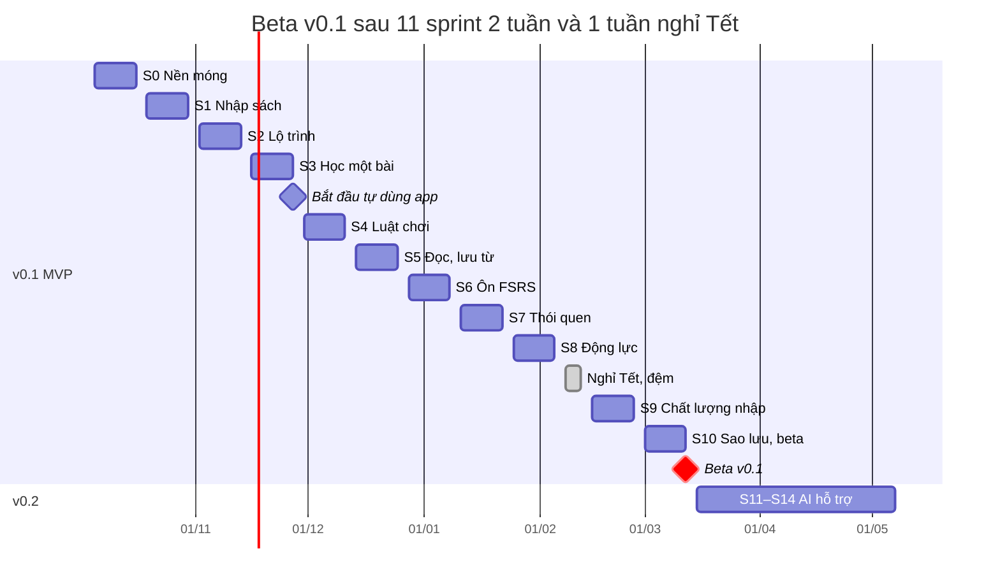

# English101 — Kế hoạch Sprint

> Phiên bản: 1.0 · Ngày: 2026-09-28 · Tham chiếu: [PRD](PRD.md) (UC, BR, NFR) · [UI/UX Flow](UI-UX-FLOWS.md) (SCR) · [Quy chuẩn code](../spec/CODING-STANDARDS.md) (DoR/DoD chung)

11 sprint 2 tuần, mỗi sprint giao một lát cắt dọc theo use case, chạy được từ UI đến database. Beta v0.1 phát hành ngày **2027-03-12**.

---

## 1. Lộ trình tổng thể

Mỗi sprint giao một nhóm use case chạy được từ UI đến database; từ S3 chủ dự án học bằng chính app mỗi ngày.

Tuần nghỉ Tết đặt sau S8 và cần dời theo lịch nghỉ thực tế; mọi sprint sau đó trượt theo.

| Sprint | Thời gian | Use case | Kết quả demo |
| --- | --- | --- | --- |
| S0 | 05/10 – 16/10/2026 | Nền cho mọi UC | App 5 tab chạy trên máy thật, CI xanh, 4 spike có kết luận |
| S1 | 19/10 – 30/10/2026 | UC-02, UC-04 | Nhập 3 cuốn EPUB, TXT, PDF và xem mục lục |
| S2 | 02/11 – 13/11/2026 | UC-06, UC-07, UC-03 cơ bản | Sách thành lộ trình node trong dưới 3 phút |
| S3 | 16/11 – 27/11/2026 | UC-08 | Xong một bài 12 câu ở chế độ máy bay |
| S4 | 30/11 – 11/12/2026 | UC-08, UC-09, UC-10, UC-21 | Hết tim, hồi tim, vượt Kiểm tra để nhảy unit |
| S5 | 14/12 – 25/12/2026 | UC-11 đến UC-14 | Đọc một chương, lưu 5 từ và 1 cụm từ |
| S6 | 28/12/2026 – 08/01/2027 | UC-15, UC-16, UC-09 | Ngày hôm sau ôn đúng các từ đã lưu |
| S7 | 11/01 – 22/01/2027 | UC-01, UC-17, UC-18, UC-19, UC-25 | Cài mới → onboarding → streak 1 → nhận nhắc nhở |
| S8 | 25/01 – 05/02/2027 | UC-20 đến UC-23 | Xong 3 nhiệm vụ, mở rương, mua đóng băng |
| Tết | 08/02 – 12/02/2027 | — | Nghỉ, chỉ sửa lỗi nếu muốn |
| S9 | 15/02 – 26/02/2027 | UC-03 đầy đủ, UC-05 | Nhập PDF hai cột và PDF scan |
| S10 | 01/03 – 12/03/2027 | UC-24, UC-25 | Tester cài beta, sao lưu và khôi phục qua máy khác |

---

## 2. Nhịp làm việc và giả định năng lực

Kế hoạch giả định một người làm khoảng 20 giờ mỗi tuần có AI hỗ trợ, tức khoảng 40 giờ mỗi sprint 2 tuần; 32 giờ dành cho story cam kết, 8 giờ đệm cho lỗi và việc phát sinh.

- **Ước lượng:** story point Fibonacci (1, 2, 3, 5, 8); 1 điểm khoảng 1,5–2 giờ; mỗi sprint kế hoạch 17–21 điểm. Velocity thật đo từ S1 và dùng để chỉnh các sprint sau.
- **Nếu làm toàn thời gian (40 giờ/tuần):** giữ nguyên nội dung từng sprint nhưng rút còn 1 tuần; beta v0.1 về khoảng cuối tháng 12/2026.
- **Cut line:** mỗi sprint ghi rõ story Must và Stretch; thứ Tư tuần 2 mà Must có nguy cơ trễ thì bỏ Stretch và làm mỏng lát cắt, không bỏ DoD.
- **Tự dùng sản phẩm:** từ S3, mỗi ngày chủ dự án học ít nhất 1 bài bằng app trước khi code (giảm rủi ro R5).
- **Bảng công việc:** GitHub Projects với các cột Backlog → Ready → In progress → Review → Done; tối đa 2 việc đang làm cùng lúc.

| Nghi thức | Khi nào | Thời lượng | Đầu ra |
| --- | --- | --- | --- |
| Planning | Thứ Hai tuần 1 | 1 giờ | Mục tiêu sprint, danh sách story đạt DoR |
| Nhật ký hằng ngày | Mỗi buổi làm | 5 phút | Hôm qua, hôm nay, vướng mắc ghi trong issue của sprint |
| Kiểm tra giữa kỳ | Thứ Tư tuần 2 | 15 phút | Quyết định cut line |
| Refinement | Thứ Năm tuần 2 | 1 giờ | Story sprint sau đạt DoR |
| Review và demo | Thứ Sáu tuần 2 | 30 phút | Video 3 phút, APK gắn tag |
| Retro | Thứ Sáu tuần 2 | 20 phút | Giữ, Vấn đề, Thử ghi vào Discussions |

DoR và DoD chung cho story và sprint nằm trong [Quy chuẩn code, mục 8](../spec/CODING-STANDARDS.md#8-definition-of-ready-và-definition-of-done); mỗi sprint dưới đây cộng thêm DoD riêng.

---

## 3. Sprint 0 — Nền móng và walking skeleton

**Thời gian:** 2026-10-05 đến 2026-10-16. **Mục tiêu:** app chạy trên Android với khung kiến trúc đầy đủ, CI xanh, và 4 rủi ro kỹ thuật lớn nhất đã có kết luận. **Use case:** nền cho mọi UC; walking skeleton cho UC-04 (Thư viện rỗng).

| ID | Story hoặc spike | Tiêu chí chấp nhận chính | Điểm |
| --- | --- | --- | --- |
| US-0.1 | Là contributor, tôi clone repo và chạy được app cùng test trong ≤ 30 phút | README có đủ lệnh; `melos run test:dart` xanh; app mở trên emulator | 3 |
| US-0.2 | Là chủ dự án, mọi PR tự chạy format, analyze, test, check:deps | ci xanh trên main; PR vi phạm quy tắc phụ thuộc bị chặn | 3 |
| US-0.3 | Là người học, tôi mở app thấy 5 tab và Thư viện rỗng có nút Nhập sách | Đi đủ WatchLibraryUseCase → DriftBookRepository → SQLite | 3 |
| US-0.4 | Là dev, tôi có token, theme sáng/tối, font Nunito và ChunkyButton | Golden 4 biến thể; unit test tương phản token | 2 |
| SP-1 | Spike PDF: pdfrx_engine trích chữ và outline trên 3 PDF (1 sách đã mua, 2 phạm vi công cộng) | Báo cáo % trang có chữ, có outline hay không, tốc độ, kết luận go/no-go | 3 |
| SP-2 | Spike EPUB: parser archive + xml đọc spine và nav của 3 EPUB | Nguyên mẫu BDM và thời gian parse | 2 |
| SP-3 | Spike FSRS và TTS: vòng Scheduler/Card/ReviewLog; flutter_tts offline trên máy thật | Test vector FSRS; danh sách giọng offline | 1 |
| SP-4 | Spike từ điển: trích Anh–Việt từ Wiktextract cho 3.000 lemma phổ biến | Độ phủ %, kích thước gói; quyết Q5 | 2 |

Tổng 19 điểm. Công việc theo lớp:

- **Repo:** pub workspace với 11 package rỗng, `.fvmrc`, lefthook, LICENSE, CONTRIBUTING, Code of Conduct, mẫu issue và PR.
- **Domain core:** Result, Failure, Clock, IdGenerator (UUIDv7), EventBus, port UnitOfWork.
- **Data:** AppDatabase (Drift) schema v1 với books và settings; khung test migration.
- **App:** bootstrap, ProviderScope, go_router với 5 tab, l10n vi/en, theme.

DoD riêng của sprint:

- [ ] CI xanh trên main; APK debug build được trên CI.
- [ ] ADR-001 đến ADR-005 nằm trong `docs/spec/adr`.
- [ ] 4 báo cáo spike trong `docs/spec/spikes`, mỗi báo cáo có kết luận go/no-go.
- [ ] Q1, Q3, Q4, Q5 đã chốt.

**Demo:** mở app trên máy thật, chuyển qua 5 tab, xem CI xanh. **Cut line:** spike PDF không đạt thì S1 tập trung EPUB, TXT, MD và dời PDF sang S9.

---

## 4. Sprint 1 — Nhập sách → Thư viện

**Thời gian:** 2026-10-19 đến 2026-10-30. **Mục tiêu:** người học nhập được sách EPUB, TXT, MD, PDF có lớp chữ và thấy mục lục trong Thư viện. **Use case:** UC-02, UC-04.

| ID | User story | Tiêu chí chấp nhận chính | Điểm |
| --- | --- | --- | --- |
| US-1.1 | Là người học, tôi nhập file EPUB, TXT, MD và thấy sách trong Thư viện với bìa, tên, số chương | BR-IMP-01, 03, 05; mục lục khớp nav của EPUB | 5 |
| US-1.2 | Là người học, tôi nhập PDF có lớp chữ; mỗi mục outline cấp 1 thành một chương | BR-IMP-05, 06, 07 | 5 |
| US-1.3 | Là người học, tôi thấy tiến trình 5 bước và hủy được | Hủy không để lại dữ liệu; job tiếp tục sau khi app bị tắt | 3 |
| US-1.4 | Là người học, tôi nhận thông báo rõ khi file có DRM, hỏng, trùng hoặc quá 150 MB | Thông điệp theo [UI/UX Flow, mục 4](UI-UX-FLOWS.md#4-flow-nhập-sách--lộ-trình) | 2 |
| US-1.5 | Là người học, tôi xem mục lục và xóa sách | Xóa sách giữ nguyên Từ của tôi | 2 |

Tổng 17 điểm. Công việc theo lớp:

- **UI:** SCR-02 Thư viện, SCR-03 Đang chuẩn bị sách, màn mục lục.
- **Domain:** Book, Section, Block, ImportJob (máy trạng thái); ImportBookUseCase, WatchLibraryUseCase, DeleteBookUseCase.
- **Ingestion:** EpubParser, TxtParser, MdParser, PdfTextParser; Normalizer; TocDetector, OutlineDetector, HeadingPatternDetector, LengthChunker.
- **Data:** bảng books, import_jobs, sections, blocks; lưu file gốc vào thư mục riêng của app.
- **Test:** snapshot cây section cho 6 fixture; test hủy và tiếp tục job.

DoD riêng của sprint:

- [ ] 6 fixture (2 EPUB, 1 TXT, 1 MD, 2 PDF) nhập thành công, snapshot đã review.
- [ ] EPUB 300 trang ≤ 20 giây, PDF 300 trang ≤ 60 giây trên máy tham chiếu (NFR-04).
- [ ] Nhập thành công ở chế độ máy bay.

**Demo:** nhập 3 cuốn trên máy thật, trong đó có cuốn PDF chủ dự án đang học. **Cut line:** PDF bố cục phức tạp chấp nhận chia theo độ dài kèm cảnh báo, xử lý triệt để ở S9.

---

## 5. Sprint 2 — Sinh lộ trình → màn Lộ trình

**Thời gian:** 2026-11-02 đến 2026-11-13. **Mục tiêu:** sách vừa nhập tự thành lộ trình node kiểu Duolingo và người học chạm được node đầu tiên. **Use case:** UC-06, UC-07, UC-03 (cơ bản), UC-04 (chọn sách đang học).

| ID | User story | Tiêu chí chấp nhận chính | Điểm |
| --- | --- | --- | --- |
| US-2.1 | Là người học, sách vừa nhập tự sinh lộ trình theo BR-PATH-01 đến 08 | Cùng seed cho cùng lộ trình (snapshot); AC của UC-06 | 8 |
| US-2.2 | Là người học, tôi chọn trình độ A1–B2 trước khi sinh (tạm thời, onboarding đầy đủ ở S7) | Từ mục tiêu thay đổi theo trình độ (BR-PATH-05) | 2 |
| US-2.3 | Là người học, tôi thấy lộ trình zigzag, banner unit, node khóa/mở/xong và nút về vị trí hiện tại | Cuộn 60 fps với 50 unit | 5 |
| US-2.4 | Là người học, chạm node mở popover có nút BẮT ĐẦU +10 XP | Theo SCR-06 | 2 |
| US-2.5 | Là người học, tôi đổi tên hoặc loại trừ unit rồi sinh lại lộ trình | Giữ tiến độ của unit không đổi | 3 |

Tổng 20 điểm. Công việc theo lớp:

- **nlp:** tách câu, token, lemma (bảng forms), tra tần suất và CEFR.
- **course_builder:** TargetSelector, KeySentenceSelector, PathPlanner.
- **Domain:** Course, Unit, PathNode; GenerateCourseUseCase, ObservePathUseCase.
- **Data:** bảng courses, units, path_nodes; dữ liệu tần suất và CEFR-J trong gói dữ liệu.
- **UI:** SCR-05, SCR-06, SCR-07; top bar tạm với streak, gem, tim giữ chỗ.

DoD riêng của sprint:

- [ ] Sinh lộ trình ≤ 30 giây cho sách 300 trang.
- [ ] Mọi node có nhãn Semantics; trace cuộn đạt 60 fps.
- [ ] Giấy phép dữ liệu tần suất đã xác minh (PRD mục 9.3).

**Demo:** từ lúc chọn file đến lúc thấy lộ trình dưới 3 phút (G1). **Cut line:** US-2.5 là Stretch; chọn từ kém thì chỉnh ngưỡng trong GameRules thay vì viết lại thuật toán.

---

## 6. Sprint 3 — Học một bài

**Thời gian:** 2026-11-16 đến 2026-11-27. **Mục tiêu:** người học hoàn thành phiên 12 câu với 5 dạng bài, nhận XP và mở node kế; từ cuối sprint chủ dự án học bằng app mỗi ngày. **Use case:** UC-08.

| ID | User story | Tiêu chí chấp nhận chính | Điểm |
| --- | --- | --- | --- |
| US-3.1 | Là người học, tôi làm phiên 12 câu có thanh tiến độ và nút KIỂM TRA | SCR-08; mỗi câu trả lời được lưu ngay (NFR-07) | 5 |
| US-3.2 | Là người học, tôi gặp 5 dạng bài: select_meaning, match_pairs, listen_select, cloze_choice, word_order | Mỗi generator có test thuộc tính theo BR-PATH-07 | 8 |
| US-3.3 | Là người học, tôi thấy dải phản hồi xanh/đỏ kèm âm thanh và rung | SCR-09; TalkBack đọc kết quả | 3 |
| US-3.4 | Là người học, xong bài tôi thấy XP, độ chính xác, thời gian; node tăng tiến độ và mở node kế | SCR-10; BR-XP-01; AC của UC-08 | 3 |

Tổng 19 điểm. Công việc theo lớp:

- **course_builder:** 5 ExerciseGenerator kèm bộ chọn phương án nhiễu.
- **Domain:** LessonSession, Attempt, rule chấm điểm BR-LES-03, XpLedger; StartLesson, SubmitAnswer, CompleteLesson; sự kiện LessonCompleted.
- **Data:** bảng lesson_sessions, attempts, xp_events, exercises.
- **Platform:** FlutterTtsService, âm thanh phản hồi, rung.
- **UI:** player, registry ExerciseRenderer, FeedbackSheet, màn Hoàn thành bài.

DoD riêng của sprint:

- [ ] ≥ 30 test chuẩn hóa đáp án cho BR-LES-03.
- [ ] E2E Patrol: nhập sách mẫu → xong bài 1.
- [ ] Chủ dự án học ít nhất 1 bài mỗi ngày bằng app từ ngày cuối sprint.

**Demo:** hoàn thành một bài trên máy thật ở chế độ máy bay. **Cut line:** word_order khó trên màn nhỏ thì giới hạn câu 5–12 token; listen_select là Stretch nếu TTS có vấn đề.

---

## 7. Sprint 4 — Luật chơi trong bài

**Thời gian:** 2026-11-30 đến 2026-12-11. **Mục tiêu:** bài học có đủ luật chơi: tim, sửa câu sai, cấp 2 khó hơn, rương, Kiểm tra unit và nhảy cóc. **Use case:** UC-08 (mở rộng), UC-09, UC-10, UC-21 (rương).

| ID | User story | Tiêu chí chấp nhận chính | Điểm |
| --- | --- | --- | --- |
| US-4.1 | Là người học, sai thì mất tim; hết tim thì chọn hồi bằng gem, chờ hoặc thoát | BR-HRT-01 đến 05; lựa chọn "luyện tập để hồi tim" nối vào ở S6 | 5 |
| US-4.2 | Là người học, câu sai được hỏi lại cuối phiên | BR-LES-02 | 2 |
| US-4.3 | Là người học, tôi làm 3 dạng tự viết ra: cloze_type, dictation, select_word; lỗi chính tả nhỏ vẫn được tính đúng | BR-LES-04 | 5 |
| US-4.4 | Là người học, mỗi node có 2 cấp và cấp 2 khó hơn | BR-PATH-03 | 2 |
| US-4.5 | Là người học, tôi mở rương nhận gem và làm Kiểm tra unit để hoàn thành hoặc nhảy tới unit sau | BR-PATH-04, BR-GEM-01 | 5 |
| US-4.6 | Là người học, thoát giữa bài có hộp thoại xác nhận; đúng 5 câu liên tiếp có lời khen | BR-LES-05 | 1 |

Tổng 20 điểm. Công việc theo lớp:

- **Domain:** aggregate Wallet (gem, tim, đóng băng) với wallet_events; HeartPolicy tính tim khi đọc; CheckpointUseCase; GameRules chứa mọi con số kinh tế.
- **course_builder:** 3 generator tự viết ra và bộ phân cấp độ khó theo cấp.
- **UI:** SCR-11 (cảnh báo và hết tim), SCR-12 (Kiểm tra unit), hoạt ảnh mở rương.

DoD riêng của sprint:

- [ ] Test hồi tim bằng FakeClock qua nửa đêm và khi đổi múi giờ.
- [ ] Test bảng cho BR-GEM-01 đến 03; số dư không bao giờ âm.
- [ ] E2E Patrol: thua vì hết tim → hồi bằng gem → tiếp tục bài.

**Demo:** vượt Kiểm tra unit 1 để nhảy sang unit 2. **Cut line:** US-4.6 là Stretch; kinh tế gem lệch thì chỉnh GameRules, không sửa code.

---

## 8. Sprint 5 — Đọc và bôi đen → Từ của tôi

**Thời gian:** 2026-12-14 đến 2026-12-25. **Mục tiêu:** người học đọc chương sách trong trình đọc, chạm tra nghĩa offline và lưu từ, cụm từ vào Từ của tôi. **Use case:** UC-11, UC-12, UC-13, UC-14.

| ID | User story | Tiêu chí chấp nhận chính | Điểm |
| --- | --- | --- | --- |
| US-5.1 | Là người học, node Đọc mở trình đọc có chỉnh cỡ chữ, nền và đọc câu bằng TTS | SCR-14 | 3 |
| US-5.2 | Là người học, chạm một từ để xem nghĩa, IPA, loại từ và nghe phát âm mà không cần mạng | NFR-05: ≤ 50 ms p95 | 5 |
| US-5.3 | Là người học, tôi lưu từ kèm câu gốc, và nhấn giữ kéo để lưu cụm từ | AC của UC-13; BR-VOC-01 đến 03 | 5 |
| US-5.4 | Là người học, từ đã lưu được tô màu theo trạng thái ở mọi sách | BR-VOC-06 | 2 |
| US-5.5 | Là người học, tôi tìm, lọc, sửa nghĩa, đánh dấu đã biết và xóa trong Từ của tôi | SCR-16, SCR-17 | 3 |
| US-5.6 | Là người học, xong bài đọc tôi làm 3 câu nhớ lại và nhận 10 XP | BR-XP-01 | 2 |

Tổng 20 điểm. Công việc theo lớp:

- **tools/dict_builder:** dựng gói từ điển v0 từ Wiktextract, WordNet, CEFR-J; màn tải gói lần đầu.
- **dictionary:** đọc gói SQLite, tra theo lemma và loại từ.
- **Domain:** VocabEntry, VocabContext, Highlight; SaveWordUseCase, LookupWordUseCase, MarkKnownUseCase.
- **Data:** bảng vocab_entries, vocab_contexts, highlights.
- **UI:** trình đọc dựng từ TextSpan theo token, LookupSheet, Từ của tôi, Chi tiết từ.

DoD riêng của sprint:

- [ ] Neo highlight vẫn đúng sau khi sinh lại lộ trình (có test).
- [ ] Màn Giấy phép liệt kê nguồn dữ liệu từ điển.
- [ ] E2E Patrol: đọc → lưu 3 từ → thấy trong Từ của tôi.

**Demo:** đọc một chương sách thật, lưu 5 từ và 1 cụm từ. **Cut line:** tuần Giáng sinh có thể thiếu giờ; phần lưu cụm từ của US-5.3 và US-5.6 là Stretch, chuyển sang S6 nếu cần.

---

## 9. Sprint 6 — Ôn tập FSRS

**Thời gian:** 2026-12-28 đến 2027-01-08. **Mục tiêu:** từ đã lưu và từ đã học trong bài được ôn đúng lúc bằng FSRS; luyện tập được hồi tim. **Use case:** UC-15, UC-16, UC-09 (nối luyện tập hồi tim).

| ID | User story | Tiêu chí chấp nhận chính | Điểm |
| --- | --- | --- | --- |
| US-6.1 | Là người học, mỗi từ sinh thẻ Nhận diện, Điền từ, Nghe; từ học trong bài vào thẳng trạng thái ôn | BR-SRS-02, BR-LES-06 | 5 |
| US-6.2 | Là người học, tab Ôn tập cho biết số thẻ đến hạn và bắt đầu phiên 20 thẻ, tối đa 10 thẻ mới | BR-SRS-03, 05; BR-VOC-05 | 5 |
| US-6.3 | Là người học, tôi tự chấm 4 mức với khoảng ôn dự kiến; thẻ gõ tự quy đổi rating | BR-SRS-04; AC của UC-15 | 3 |
| US-6.4 | Là người học, kết thúc phiên tôi thấy tổng kết, XP và +1 tim mỗi 10 thẻ | BR-HRT-03; lựa chọn hồi tim ở S4 dẫn vào đây | 2 |
| US-6.5 | Là người học, node Luyện tập và 2 câu khởi động mỗi bài dùng thẻ đến hạn | BR-LES-01 | 3 |

Tổng 18 điểm. Công việc theo lớp:

- **srs:** FsrsScheduler bọc package fsrs 2.0.1 (desiredRetention 0,9; learningSteps 1 và 10 phút; relearning 10 phút; tối đa 365 ngày; bật fuzzing).
- **Domain:** Card, ReviewLog; ReviewCardUseCase, BuildReviewQueueUseCase (hạn mức, chôn thẻ anh em).
- **Data:** bảng cards, review_logs; chỉ mục due_at.
- **UI:** SCR-18 Tổng quan ôn, SCR-19 Phiên ôn và tổng kết.

DoD riêng của sprint:

- [ ] Test vector FSRS khớp output thư viện; thẻ anh em không xuất hiện cùng ngày.
- [ ] Truy vấn thẻ đến hạn ≤ 30 ms với 10.000 thẻ.
- [ ] Menu debug "tua thời gian" (chỉ bản debug) để kiểm lịch ôn.

**Demo:** lưu từ hôm nay, tua sang hôm sau, ôn và thấy lịch mới. **Cut line:** US-6.5 là Stretch; nếu trễ, node Luyện tập tạm dùng phiên ôn chung.

---

## 10. Sprint 7 — Thói quen

**Thời gian:** 2027-01-11 đến 2027-01-22. **Mục tiêu:** người mới đi qua onboarding 8 bước và giữ streak mỗi ngày nhờ mục tiêu ngày, đóng băng và nhắc nhở cục bộ. **Use case:** UC-01, UC-17, UC-18, UC-19, UC-25.

| ID | User story | Tiêu chí chấp nhận chính | Điểm |
| --- | --- | --- | --- |
| US-7.1 | Là người mới, tôi đi qua onboarding 8 bước và vào bài đầu tiên | ≤ 90 giây tới bài đầu, chưa tính nhập sách | 5 |
| US-7.2 | Là người học, tôi thấy tiến độ mục tiêu ngày và màn Đạt mục tiêu | BR-GOAL-01 | 2 |
| US-7.3 | Là người học, streak tăng khi đạt 10 XP; có màn ăn mừng và màn Streak với lịch | BR-STK-01, 02, 05; AC của UC-17 | 5 |
| US-7.4 | Là người học, đóng băng tự dùng khi tôi lỡ ngày và tôi mua được bằng gem | BR-STK-03, 04 | 3 |
| US-7.5 | Là người học, tôi nhận nhắc hằng ngày và nhắc streak sắp mất; nội dung xoay vòng và tự giảm khi tôi bỏ học | BR-NTF-01 đến 05 | 5 |
| US-7.6 | Là người học, tôi chỉnh mục tiêu, giờ nhắc, giờ bắt đầu ngày, âm thanh và rung | SCR-26 | 1 |

Tổng 21 điểm. Công việc theo lớp:

- **Domain:** LearningDay, StreakPolicy, NotificationPlanner; EnsureDayClosedUseCase, handler UpdateDailyActivity.
- **Data:** bảng daily_activity, streak_state, settings.
- **Platform:** flutter_local_notifications + timezone; màn giải thích trước khi xin quyền.
- **UI:** SCR-01 Onboarding, SCR-20 ăn mừng, SCR-21 Streak, mascot Rive.

DoD riêng của sprint:

- [ ] ≥ 25 kịch bản test bảng cho streak: giờ bắt đầu ngày, đổi múi giờ, nhiều ngày lỡ, đóng băng.
- [ ] Thông báo kiểm trên Android 13 trở lên, có và không có quyền.
- [ ] Thử onboarding với 3 người, trung vị ≤ 90 giây.

**Demo:** cài mới → onboarding → bài 1 → streak 1 → tua giờ và nhận nhắc nhở hôm sau. **Cut line:** US-7.6 và nhắc "từ sắp quên" là Stretch; hệ điều hành hoãn thông báo thì chấp nhận lịch không chính xác và ghi vào FAQ.

---

## 11. Sprint 8 — Động lực

**Thời gian:** 2027-01-25 đến 2027-02-05. **Mục tiêu:** nhiệm vụ ngày, cửa hàng, thành tích và hồ sơ cho người học lý do quay lại ngoài streak. **Use case:** UC-20, UC-21, UC-22, UC-23.

| ID | User story | Tiêu chí chấp nhận chính | Điểm |
| --- | --- | --- | --- |
| US-8.1 | Là người học, mỗi ngày tôi có 3 nhiệm vụ với tiến độ và rương thưởng | BR-QST-01 đến 03 | 5 |
| US-8.2 | Là người học, tôi mua đóng băng và hồi đầy tim trong cửa hàng | BR-GEM-02 | 2 |
| US-8.3 | Là người học, tôi mở khóa thành tích nhiều bậc và xem lưới huy hiệu | BR-ACH-01 | 5 |
| US-8.4 | Là người học, hồ sơ cho tôi thấy tổng XP, streak dài nhất, từ thành thạo, unit đã xong, lịch nhiệt 12 tuần, XP 7 ngày | SCR-24 | 5 |
| US-8.5 | Là người học, top bar hiện số thật của streak, gem và tim | SCR-05 | 1 |

Tổng 18 điểm. Công việc theo lớp:

- **Domain:** QuestBoard (sinh theo seed ngày học, trọng số theo nhu cầu), AchievementRules, Shop; các handler sự kiện.
- **Data:** bảng quests, achievements; truy vấn thống kê từ xp_events và review_logs.
- **UI:** SCR-22 Nhiệm vụ, SCR-23 Cửa hàng, SCR-24 Hồ sơ, SCR-25 Thành tích.

DoD riêng của sprint:

- [ ] Mỗi mẫu nhiệm vụ và mỗi thành tích có test.
- [ ] Mô phỏng 30 ngày: người xong 60% nhiệm vụ mua được khoảng 1 đóng băng mỗi tuần; số dư gem không âm.
- [ ] Có danh sách ≥ 12 tester cho closed testing trên Google Play (chuẩn bị S10, rủi ro R10).

**Demo:** một ngày học xong 3 nhiệm vụ → mở rương → mua đóng băng. **Cut line:** US-8.3 là Stretch; không bao giờ thưởng XP hay gem cho việc lưu từ hàng loạt.

Sau S8 là tuần nghỉ Tết (08/02–12/02/2027): không nhận việc mới, chỉ sửa lỗi nếu muốn.

---

## 12. Sprint 9 — Chất lượng nhập sách

**Thời gian:** 2027-02-15 đến 2027-02-26. **Mục tiêu:** sách khó (PDF hai cột, PDF scan, cấu trúc lạ) vẫn thành lộ trình dùng được, và người học sửa được cấu trúc trước khi học. **Use case:** UC-03 (wizard đầy đủ), UC-05.

| ID | User story | Tiêu chí chấp nhận chính | Điểm |
| --- | --- | --- | --- |
| US-9.1 | Là người học, sau khi phân tích tôi duyệt cấu trúc: gộp, tách, đổi tên, loại trừ, xem trước | SCR-04 đầy đủ theo [UI/UX Flow, mục 4](UI-UX-FLOWS.md#4-flow-nhập-sách--lộ-trình) | 5 |
| US-9.2 | Là người học, PDF hai cột và PDF có header/footer vẫn tách câu đúng | Dùng toạ độ ký tự từ loadStructuredText; BR-IMP-07 | 5 |
| US-9.3 | Là người học, PDF scan được đề xuất nhận dạng chữ trên máy, có tiến độ và hủy được | 50 trang ≤ 3 phút trên máy tham chiếu | 5 |
| US-9.4 | Là người học, sinh lại lộ trình sau khi sửa cấu trúc vẫn giữ tiến độ unit không đổi | UC-06 luồng A3 | 2 |
| US-9.5 | Là người học, tôi xem báo cáo chất lượng nhập và gửi báo lỗi không kèm nội dung sách | Issue được điền sẵn thống kê cấu trúc | 1 |

Tổng 18 điểm. Công việc theo lớp:

- **Ingestion:** ColumnLayoutAnalyzer, HeaderFooterStripper, AnswerKeyDetector, OcrAdapter theo kết quả spike đầu sprint.
- **Domain:** RestructureBookUseCase; so sánh content_hash để giữ tiến độ.
- **UI:** wizard duyệt cấu trúc, màn đề xuất OCR, báo cáo chất lượng.

DoD riêng của sprint:

- [ ] Tỷ lệ nhập thành công trên bộ fixture: EPUB/TXT/MD ≥ 90%, PDF có chữ ≥ 75% (G4).
- [ ] Quyết định OCR (ML Kit hay Tesseract) ghi thành ADR.

**Demo:** nhập một PDF hai cột và một PDF scan phạm vi công cộng. **Cut line:** US-9.3 là Should; nếu OCR kém thì hiện cảnh báo trước khi chạy và cho hủy, hoặc dời sang v0.2.

---

## 13. Sprint 10 — Sao lưu, hoàn thiện, phát hành beta

**Thời gian:** 2027-03-01 đến 2027-03-12. **Mục tiêu:** dữ liệu an toàn nhờ sao lưu và khôi phục, app đạt mọi NFR, beta v0.1 tới tay tester. **Use case:** UC-24, UC-25 (hoàn thiện).

| ID | User story | Tiêu chí chấp nhận chính | Điểm |
| --- | --- | --- | --- |
| US-10.1 | Là người học, tôi tạo bản sao lưu một file và khôi phục trên máy khác | NFR-14; xác nhận trước khi ghi đè | 5 |
| US-10.2 | Là người học, app tự sao lưu hằng tuần và giữ 3 bản gần nhất | Khôi phục được từ bản tự động | 2 |
| US-10.3 | Là người học, tôi xem Giấy phép, ghi công dữ liệu và chính sách quyền riêng tư | NFR-15 | 2 |
| US-10.4 | Là người dùng TalkBack hoặc cỡ chữ lớn, tôi dùng được mọi màn chính | NFR-10 | 3 |
| US-10.5 | Là chủ dự án, app đạt ngân sách hiệu năng và kích thước | NFR-02 đến NFR-06 | 3 |
| US-10.6 | Là tester, tôi cài beta từ Play closed testing hoặc GitHub Releases | Workflow release; store listing; khai báo Data safety | 3 |

Tổng 18 điểm. File sao lưu là một file zip gồm SQLite, file sách gốc và manifest (phiên bản schema, ngày tạo); khôi phục chạy migration nếu schema cũ hơn.

Release DoD cho beta v0.1:

- [ ] Mọi use case Must của v0.1 đạt DoD.
- [ ] Không còn lỗi P0 hoặc P1 đang mở.
- [ ] Sao lưu → khôi phục đã kiểm trên 2 máy khác nhau.
- [ ] Crash-free ≥ 99,5% trong 7 ngày tự dùng và tester dùng.
- [ ] 5 flow E2E xanh; ngân sách NFR đạt.
- [ ] Tag `v0.1.0`, release notes, README có ảnh và hướng dẫn cài.
- [ ] Closed testing trên Play bắt đầu với ≥ 12 tester trong 14 ngày (nếu phát hành qua Play).

**Demo:** tester cài beta từ Play hoặc GitHub, sao lưu trên máy cũ và khôi phục trên máy mới. **Cut line:** closed testing chưa đủ 14 ngày thì phát hành beta qua GitHub Releases trước, Play sau.

---

## 14. Sau MVP: v0.2 và v1.0

v0.2 chạy ngay sau beta nhưng có một cổng go/no-go sau 30 ngày beta: chủ dự án học ≥ 80% số ngày và crash-free ≥ 99,5%. Điểm quyết định: **2027-04-12**; nếu chưa đạt, S13 và S14 chuyển sang sửa lỗi và cải thiện thói quen thay vì làm tính năng AI mới.

| Sprint | Phạm vi | Use case |
| --- | --- | --- |
| S11 | Cấu hình AI tự mang key: danh sách model, đếm token, ước tính chi phí, đồng ý theo từng sách; AnthropicLlmProvider và FakeLlmProvider | UC-26 |
| S12 | AI trích cấu trúc sách ngữ pháp (giải thích, bài tập, đáp án từ phần Key) qua JSON Schema; trình sửa khóa học | UC-27 |
| S13 | Dạng bài mới từ AI: dịch câu, biến đổi ngữ pháp, sửa lỗi, đọc hiểu; nhận xét câu viết | UC-27, UC-28 |
| S14 | Xem trang PDF gốc kèm highlight; tối ưu tham số FSRS cá nhân; analytics opt-in; giao diện tiếng Anh; iOS qua TestFlight | — |

v1.0 (từ tháng 5/2027, khoảng 6 sprint): tài khoản và đồng bộ đa thiết bị dựa trên log chỉ-ghi-thêm (Supabase + lớp sync), bạn bè và giải đấu tuần, bài nói với nhận dạng giọng nói trên máy, giao diện iPad chia đôi màn hình, widget streak, chia sẻ gói khóa học nội dung mở (UC-29, UC-30).
