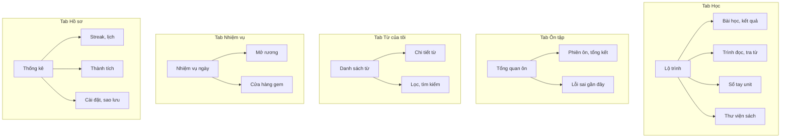
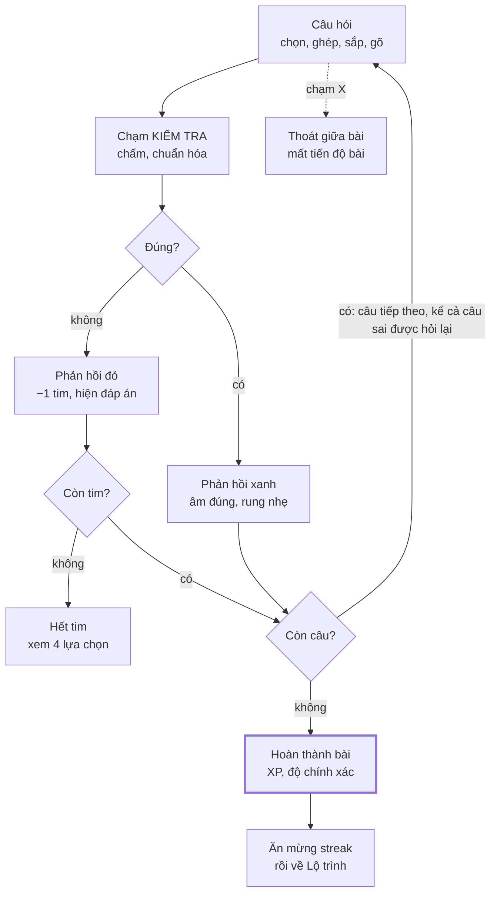

# English101 — UI/UX Flow

> Phiên bản: 1.1 · Ngày: 2026-09-28 · Tham chiếu: [PRD](PRD.md) (mã UC, BR) · [Kế hoạch Sprint](SPRINT-PLAN.md) (sprint giao từng màn)

Mô phỏng UI/UX của Duolingo ở mức rất gần (lộ trình node, bài học từng câu, phản hồi xanh/đỏ, streak, bố cục, hoạt ảnh, tinh thần âm thanh); ranh giới bắt buộc khác biệt chỉ còn thương hiệu và mascot (Mọt thay Duo) — chi tiết và rủi ro ở [PRD §9.2](PRD.md#92-ranh-giới-khi-mô-phỏng-duolingo).

---

## 1. Nguyên tắc thiết kế

English101 mô phỏng sát cấu trúc tương tác của Duolingo vì nó đã được kiểm chứng trên hàng trăm triệu người học. Ba điểm khác: có trình đọc sách, có kho từ cá nhân, và không có yếu tố xã hội ở v0.1.

1. **Một màn hình, một việc.** Mỗi câu hỏi chiếm trọn màn hình, chỉ có một nút hành động chính ở đáy (KIỂM TRA → TIẾP TỤC).
2. **Phản hồi tức thì, nhiều giác quan.** Màu, biểu tượng, chữ, âm thanh và rung cùng báo kết quả; không bao giờ chỉ dùng màu.
3. **Tiến độ luôn nhìn thấy.** Thanh tiến độ bài, số streak trên top bar, trạng thái node, nhiệm vụ ngày.
4. **Thưởng nhỏ, thường xuyên.** XP sau mỗi bài, rương, nhiệm vụ, ăn mừng streak; không thưởng cho việc lưu từ tràn lan.
5. **Mascot là giọng nói của app.** Mọt hướng dẫn, cổ vũ, nhắc nhở; hài hước nhưng không trách móc.
6. **Tha thứ.** Đóng băng streak, Chế độ thư giãn tắt tim, mục tiêu tối thiểu chỉ 10 XP.
7. **Dùng một tay.** Vùng thao tác chính nằm nửa dưới màn hình; mọi vùng chạm cao ≥ 48 dp.
8. **Offline là mặc định.** Không có spinner chờ mạng; mọi trạng thái rỗng nói rõ bước tiếp theo.

| Mẫu của Duolingo | English101 giữ | English101 điều chỉnh |
| --- | --- | --- |
| Lộ trình theo course do Duolingo biên soạn | Node xếp zigzag, banner unit, popover BẮT ĐẦU | Mỗi sách là một course, unit là chương sách; thêm node Đọc |
| Guidebook (Key phrases, Tip) | Nút Sổ tay trên banner unit | Nội dung lấy từ chính chương sách: câu then chốt và từ khóa |
| Practice Hub (Mistakes, Words, Listen, Speak) | Tab Ôn tập với Lỗi sai | Thêm tab Từ của tôi: từ bôi đen, lọc theo sách, nghĩa sửa được |
| Tim hoặc Energy, gói Super/Max | 5 tim, hồi theo thời gian, luyện tập để hồi tim | Không có gói trả phí; có Chế độ thư giãn |
| Leagues, Friends, Friend Streak | — | Không có ở v0.1 |
| Onboarding hỏi ngôn ngữ muốn học | Khung mascot + câu hỏi + nút ở đáy, thanh tiến độ trên cùng | Hỏi lý do học, trình độ, mục tiêu, kế hoạch Nếu–thì, giờ nhắc, rồi nhập sách hoặc dùng sách mẫu |

---

## 2. Kiến trúc thông tin và điều hướng

App có 5 tab cố định ở đáy; màn Bài học, Phiên ôn và Trình đọc mở toàn màn hình và ẩn tab bar, giống Duolingo ([Lộ trình có popover](https://mobbin.com/screens/3ecf07e8-cea8-4414-b5d9-05cd21033429), [chọn course](https://mobbin.com/screens/5b824729-17ea-49d8-a98a-aa3b98cbb438)).



Top bar chỉ hiện ở tab Học: bìa sách đang học (thay lá cờ course của Duolingo) mở Thư viện, lửa mở Streak, gem mở Cửa hàng, tim mở Hồi tim. Lửa streak xám khi hôm nay chưa đạt 10 XP và chuyển cam khi đã giữ streak.

Cây route cho go_router (typed routes), dùng chung cho deep link từ thông báo:

```text
/                              chuyển tới /onboarding (lần đầu) hoặc /learn
/onboarding/:step              8 bước, xem mục 3
/learn                         [tab Học] Lộ trình của sách đang học
/learn/node/:nodeId/lesson     Bài học (toàn màn hình)
/learn/node/:nodeId/result     Hoàn thành bài → streak → mục tiêu ngày
/learn/node/:nodeId/read       Trình đọc của node Đọc
/learn/node/:nodeId/checkpoint Kiểm tra unit
/learn/unit/:unitId/guide      Sổ tay unit
/library                       Thư viện (mở từ bìa sách ở top bar)
/library/import                Tiến trình nhập sách
/library/:bookId/structure     Duyệt cấu trúc sách
/library/:bookId/read          Đọc tự do cả cuốn sách
/review                        [tab Ôn tập] Tổng quan ôn
/review/session                Phiên ôn (toàn màn hình)
/review/mistakes               Lỗi sai gần đây
/words                         [tab Từ của tôi]
/words/:entryId                Chi tiết từ
/quests                        [tab Nhiệm vụ]
/profile                       [tab Hồ sơ]
/profile/streak                Lịch streak, đóng băng
/profile/achievements          Thành tích
/settings                      Cài đặt, sao lưu, giấy phép
```

---

## 3. Flow onboarding

Onboarding có 8 bước và đưa người học vào bài đầu tiên trong ≤ 90 giây (chưa tính thời gian nhập sách), không cần tài khoản. Bố cục theo [onboarding của Duolingo](https://mobbin.com/flows/b0b4f93f-5637-46ec-9d77-49ecda6b991d): thanh tiến độ và nút quay lại trên cùng, mascot nói trong bong bóng, lựa chọn dạng thẻ, nút chính ở đáy chỉ sáng khi đã chọn.

| Bước | Mọt nói | Lựa chọn | Dữ liệu lưu |
| --- | --- | --- | --- |
| 1. Chào | "Chào bạn! Mình là Mọt. Mình biến sách của bạn thành bài học mỗi ngày." | BẮT ĐẦU; KHÔI PHỤC TỪ BẢN SAO LƯU | — |
| 2. Lý do học | "Bạn học tiếng Anh để làm gì?" | Công việc, Du lịch, Thi chứng chỉ, Đọc sách và xem phim, Giao tiếp, Khác; có nút ĐỂ SAU | motivation (dùng cho nội dung nhắc nhở) |
| 3. Trình độ | "Bạn biết tiếng Anh đến đâu?" | 5 mức có vạch sóng: Mới bắt đầu (A1), Biết vài từ (A1+), Giao tiếp cơ bản (A2), Nói về nhiều chủ đề (B1), Thảo luận sâu (B2) | level_cefr (BR-PATH-05) |
| 4. Mục tiêu ngày | "Mỗi ngày bạn muốn học bao lâu?" | 5 phút Thong thả, 10 phút Vừa phải (chọn sẵn), 15 phút Nghiêm túc, 20 phút Cao độ; nút TÔI QUYẾT TÂM | daily_goal_xp (10, 20, 30, 50) |
| 5. Kế hoạch Nếu–thì | "Gắn việc học vào một thói quen bạn đã có nhé." | Sau khi pha cà phê sáng, Trên đường đi làm, Giờ nghỉ trưa, Trước khi đi ngủ, Tự nhập; hiện câu cam kết "Sau khi pha cà phê sáng, mình sẽ học 1 bài." | anchor_text |
| 6. Giờ nhắc | "Mình nhắc bạn lúc mấy giờ?" | Giờ gợi ý theo mốc ở bước 5 (07:30, 08:00, 12:30, 21:30); màn giải thích lợi ích rồi mới hiện hộp thoại quyền thông báo của hệ điều hành | reminder_time, notification_permission |
| 7. Chọn sách | "Bạn muốn học từ sách nào?" | NHẬP SÁCH CỦA TÔI (EPUB, PDF, TXT, MD); DÙNG SÁCH MẪU (truyện phạm vi công cộng, A2); sau khi nhập hỏi bắt đầu từ chương 1 hay làm Kiểm tra để nhảy chương | active_book_id |
| 8. Bài đầu tiên | Tooltip "Bắt đầu ở đây" trên node 1 | Bài học → Hoàn thành bài → "1 ngày streak" với hàng 7 ngày trong tuần → Lộ trình | streak = 1 |

Quy tắc của flow:

- Bước 2 và 5 bỏ qua được; mọi lựa chọn sửa lại trong Cài đặt.
- Từ chối quyền thông báo không chặn onboarding; màn Hồ sơ hiện lời nhắc bật lại.
- Bỏ so với Duolingo: chọn ngôn ngữ, bài kiểm tra xếp lớp, quảng cáo widget, tạo tài khoản.
- Thêm so với Duolingo: bước Nếu–thì (implementation intention, Gollwitzer và Sheeran 2006) và bước chọn sách.
- Màn mục tiêu ngày theo [flow chọn mục tiêu của Duolingo](https://mobbin.com/flows/e8ee7348-2019-4b8f-8179-7f4961ef6ea8), nhưng hiện cả phút lẫn XP để người học hiểu quy đổi.

---

## 4. Flow nhập sách → lộ trình

Nhập sách là flow tuyến tính gồm 6 màn; người học thấy từng bước xử lý và hủy được bất kỳ lúc nào (UC-02, UC-03, UC-06).

1. **Thư viện:** lưới bìa sách 2 cột, mỗi thẻ có % tiến độ và nhãn Đang học; nút nổi "+ NHẬP SÁCH". Trạng thái rỗng: Mọt ôm sách và hai nút NHẬP SÁCH, DÙNG SÁCH MẪU.
2. **Bộ chọn file** của hệ điều hành, lọc sẵn .epub, .pdf, .txt, .md.
3. **Đang chuẩn bị sách:** 5 bước được tích lần lượt (Đọc file, Làm sạch, Tách chương, Phân tích từ, Sinh lộ trình), thanh % tổng, Mọt đọc sách kèm mẹo xoay vòng, nút HỦY. Rời màn này vẫn được: job chạy tiếp khi app còn mở, và tiếp tục từ bước đã lưu nếu app bị tắt.
4. **Sách đã sẵn sàng:** bìa, tên, tác giả; ba con số (số unit, số từ mục tiêu, số ngày ước tính theo mục tiêu hiện tại, ví dụ "khoảng 45 ngày với 20 XP mỗi ngày"); cảnh báo vàng nếu có; nút phụ XEM CẤU TRÚC, nút chính BẮT ĐẦU HỌC.
5. **Duyệt cấu trúc** (UC-03): danh sách unit với số thứ tự, tên (chạm để đổi), số từ, công tắc Học/Bỏ qua; chọn 2 unit liền kề để GỘP; mở unit để xem trước và TÁCH TẠI ĐÂY; nhóm "Đã loại trừ" chứa bìa, mục lục, đáp án và bật lại được; nút chính SINH LẠI LỘ TRÌNH.
6. **Lộ trình** mở ở unit 1, hoặc ở unit đã vượt Kiểm tra để nhảy tới.

| Tình huống | Thông báo | Hành động |
| --- | --- | --- |
| File có DRM | "Cuốn này có khóa DRM nên mình không đọc được. Hãy dùng bản không DRM mà bạn sở hữu." | CHỌN FILE KHÁC |
| File hỏng hoặc sai định dạng | "Mình không mở được file này. App hỗ trợ EPUB, PDF, TXT và MD." | CHỌN FILE KHÁC |
| PDF không có lớp chữ | "Cuốn này là ảnh scan. Nhận dạng chữ trên máy mất khoảng 2–3 phút cho 50 trang." | NHẬN DẠNG CHỮ (từ S9); HỦY |
| Sách đã có trong Thư viện | "Bạn đã nhập cuốn này ngày 12/10." | MỞ SÁCH ĐÃ CÓ; NHẬP BẢN MỚI |
| File lớn hơn 150 MB | "File này lớn hơn 150 MB, mình chưa xử lý được." | CHỌN FILE KHÁC |
| Không tách được chương | Cảnh báo vàng ở màn 4: "12 unit được chia tự động theo độ dài." | XEM CẤU TRÚC |

Thẻ sách trong Thư viện có 4 trạng thái: Đang nhập (vòng tiến độ), Sẵn sàng, Cần kiểm tra (chấm vàng), Lỗi (chấm đỏ kèm THỬ LẠI). Nhấn giữ thẻ mở menu: Đặt làm sách đang học, Xem cấu trúc, Sinh lại lộ trình, Xóa sách. Xóa sách gỡ tiến độ và highlight của sách đó nhưng giữ các từ trong Từ của tôi cùng câu ngữ cảnh.

---

## 5. Flow bài học

Phiên bài học là một vòng lặp câu hỏi → KIỂM TRA → phản hồi, kết thúc khi hết câu, hết tim hoặc người học thoát (UC-08, UC-09).



Câu sai không làm kết thúc bài: nó quay lại cuối hàng đợi, nên mọi phiên hoàn thành đều kết thúc bằng một lượt trả lời đúng cho từng câu.

### Các dạng bài v0.1

| Mã | Tên | Giao diện | Cấp độ | Tham chiếu Duolingo |
| --- | --- | --- | --- | --- |
| select_meaning | Chọn nghĩa đúng | Từ tiếng Anh kèm loa, 4 thẻ nghĩa tiếng Việt | Nhận diện | — |
| select_word | Chọn từ đúng | Nghĩa tiếng Việt, 4 thẻ từ tiếng Anh | Nhận diện | — |
| match_pairs | Ghép cặp | 2 cột × 5 ô; chạm trái rồi phải, cặp đúng đổi xanh rồi mờ đi | Nhận diện | [Tap the matching pairs](https://mobbin.com/screens/8199682b-96e6-4d64-be65-98e3dd309fc2) |
| listen_select | Nghe và chọn | Nút loa lớn và loa chậm, 4 thẻ từ | Nhận diện | — |
| cloze_choice | Điền chỗ trống | Câu gốc có ô trống, 3–4 lựa chọn dạng thẻ | Nhớ lại | [Fill in the blank](https://mobbin.com/screens/57d38f9d-5bee-42f9-96f8-85b05f3bf835) |
| word_order | Sắp xếp câu | Nghe câu, xếp các ô từ vào dòng trả lời | Nhớ lại | [Word bank](https://mobbin.com/screens/3d1e792b-518f-4038-bc2c-30e1a9017893) |
| cloze_type | Gõ từ còn thiếu | Câu có ô trống, gợi ý chữ cái đầu, bàn phím | Tự viết ra | — |
| dictation | Nghe và gõ lại | Loa thường và loa chậm, ô nhập nhiều dòng | Tự viết ra | — |

### Giải phẫu màn Bài học

- **Đầu màn:** nút X, thanh tiến độ, số tim. Khi đúng liên tiếp, nhãn "5 LIÊN TIẾP" hiện trên thanh và thanh đổi sang màu cam ([tham chiếu](https://mobbin.com/screens/12e43447-33df-4196-ba31-8c2fc8deabb9)).
- **Nhãn phụ:** TỪ MỚI (tím) khi một từ xuất hiện lần đầu; KHÓ (đỏ) cho câu cấp 2 ([tham chiếu](https://mobbin.com/screens/bb075437-bdb1-4c18-ab7b-fdeb460bf3dd)).
- **Đề bài:** tiêu đề lệnh, nội dung, vùng trả lời. Từ có gạch chân chấm chạm vào được để xem nghĩa.
- **Nút KIỂM TRA:** xám khi chưa trả lời, xanh khi đã có câu trả lời.
- **Dải phản hồi đúng:** nền xanh nhạt, dấu tích, lời khen ngẫu nhiên, dòng "Nghĩa", nút cờ báo lỗi, nút TIẾP TỤC ([tham chiếu](https://mobbin.com/screens/a1d54661-39f7-4ae3-a1d5-ec01bf9f5ccb)).
- **Dải phản hồi sai:** nền đỏ nhạt, dấu X, "Đáp án đúng", "Nghĩa", nút ĐÃ HIỂU màu đỏ ([tham chiếu](https://mobbin.com/screens/81b520ac-e864-4e64-bc18-f16caca3b124)).
- **Còn 1 tim:** màn chen "Cẩn thận! Bạn chỉ còn sai được 1 lần nữa." ([tham chiếu](https://mobbin.com/screens/3c700cfa-f55b-4011-8b03-119f925788d5)).
- **Hết tim:** bottom sheet có đếm ngược tới tim tiếp theo và 4 lựa chọn: LUYỆN TẬP ĐỂ HỒI TIM, HỒI ĐẦY · 100 GEM, CHỜ, THOÁT BÀI.
- **Hoàn thành bài:** Mọt ăn mừng, tiêu đề "Hoàn thành bài!" hoặc "Hoàn hảo!", ba thẻ số TỔNG XP, CHÍNH XÁC, THỜI GIAN, nút NHẬN XP (theo màn "Learning legend!" trong [onboarding](https://mobbin.com/flows/b0b4f93f-5637-46ec-9d77-49ecda6b991d)).

---

## 6. Flow đọc, bôi đen → Từ của tôi → ôn tập

Chạm để tra, bấm một nút để lưu, và từ đã lưu tự vào hàng ôn FSRS; người học không phải tạo thẻ bằng tay (UC-11 đến UC-15).

1. Mở node Đọc trên Lộ trình, hoặc Đọc tự do từ Thư viện.
2. Chạm một từ để mở bảng tra (bottom sheet cao khoảng 40% màn hình).
3. Chạm THÊM VÀO TỪ CỦA TÔI: toast "Đã lưu give up · HOÀN TÁC" trong 4 giây, rung nhẹ, từ đổi nền vàng (Mới).
4. Cuối chương chạm HOÀN THÀNH ĐỌC: 3 câu nhớ lại (điền chỗ trống từ câu then chốt), +10 XP.
5. Khi thẻ đến hạn, tab Ôn tập hiện badge số thẻ; người học bắt đầu phiên ôn.

### Trình đọc

- **Thanh trên:** quay lại, tên chương, nút Aa (cỡ chữ, giãn dòng, nền Sáng / Sepia / Tối, font Literata hoặc Nunito), nút loa đọc cả câu và tô câu đang đọc.
- **Thân:** văn bản reflow cỡ 19/30, rộng tối đa 600 dp; từ mục tiêu của unit có gạch chân chấm; từ trong Từ của tôi được tô theo trạng thái (BR-VOC-06).
- **Đáy:** thanh tiến độ trong chương; cuối chương có nút HOÀN THÀNH ĐỌC.

| Thao tác | Kết quả |
| --- | --- |
| Chạm một từ | Mở bảng tra, chưa lưu gì |
| Chạm THÊM VÀO TỪ CỦA TÔI | Lưu từ và câu ngữ cảnh, tô màu Mới, toast có HOÀN TÁC |
| Nhấn giữ rồi kéo | Chọn 2–6 từ trong cùng câu; menu nổi Lưu cụm từ, Tra, Sao chép (như menu chọn chữ của [Pocket](https://mobbin.com/screens/340108ed-e7d6-4ea5-99ff-9f331c94b3be)) |
| Chạm từ đã lưu | Bảng tra hiện trạng thái, ngày ôn tới và nút THÊM NGỮ CẢNH NÀY |
| Chạm biểu tượng loa | Đọc từ (trong bảng tra) hoặc cả câu (thanh trên) bằng TTS |
| Vuốt xuống bảng tra | Đóng bảng |

### Bảng tra từ

- Dòng đầu: từ, IPA, nút loa, nhãn CEFR và loại từ.
- Nghĩa tiếng Việt (nghĩa hợp loại từ đứng đầu), định nghĩa tiếng Anh từ WordNet thu gọn được, câu ngữ cảnh hiện tại với từ in đậm.
- Nút chính THÊM VÀO TỪ CỦA TÔI; nút phụ "Tôi đã biết từ này" và "Sửa nghĩa".
- Dòng hạn mức: "Hôm nay còn 3 chỗ cho từ mới; từ lưu thêm sẽ vào ôn từ ngày mai."
- Không có trong từ điển: "Từ điển offline chưa có nghĩa của từ này. Bạn có thể tự nhập."

### Từ của tôi

- Đầu màn: 3 chip đếm Mới · Đang học · Thành thạo (chạm để lọc), ô tìm kiếm, nút lọc theo sách, CEFR, nguồn (bôi đen hay bài học), nhãn Khó nhớ.
- Nút ÔN 20 THẺ ở trên cùng, theo màn [Words của Duolingo](https://mobbin.com/screens/a47d0400-435b-4be7-b1ba-16cc97ad36a9).
- Mỗi dòng: từ, loa, loại từ, nghĩa một dòng, chấm trạng thái, "ôn sau 3 ngày".
- Chi tiết từ: nghĩa sửa được, ghi chú, danh sách ngữ cảnh (câu, sách, MỞ TRONG SÁCH), các thẻ với trạng thái và hạn ôn; hành động Đánh dấu đã biết, Đặt lại tiến độ, Xóa.

### Ôn tập

- **Tổng quan:** số thẻ đến hạn và số thẻ mới hôm nay, nút BẮT ĐẦU ÔN, dự báo 7 ngày tới dạng cột nhỏ, dòng Lỗi sai gần đây, bố cục khối như [Practice Hub](https://mobbin.com/screens/4c26a464-b592-403a-b3f5-849f10a766cc).
- **Thẻ Nhận diện:** mặt trước là câu gốc với từ in đậm; nút HIỆN ĐÁP ÁN; mặt sau là nghĩa, IPA, loa; 4 nút LẠI · KHÓ · TỐT · DỄ, mỗi nút ghi khoảng ôn dự kiến do FSRS tính.
- **Thẻ Điền từ và Nghe:** ô nhập + KIỂM TRA, dải phản hồi giống bài học; trả lời đúng thì có nút nhỏ "Dễ quá" để chấm Dễ.
- **Tổng kết:** số thẻ, tỷ lệ nhớ, XP, số tim hồi được, trạng thái streak.

---

## 7. Flow thói quen: mục tiêu ngày, streak, nhắc nhở, nhiệm vụ

Sau màn Hoàn thành bài, app hiện thêm tối đa 4 màn thưởng theo thứ tự cố định; ngoài bài học, thói quen được giữ bằng lịch streak, đóng băng và nhắc nhở cục bộ (UC-17 đến UC-21).

| Thứ tự | Màn | Khi nào hiện |
| --- | --- | --- |
| 1 | Hoàn thành bài: XP, % đúng, thời gian | Luôn hiện |
| 2 | Ăn mừng streak: lửa bùng, số đếm tăng, hàng 7 ngày có dấu tích (như màn "1 day streak" trong [onboarding Duolingo](https://mobbin.com/flows/b0b4f93f-5637-46ec-9d77-49ecda6b991d)) | Lần đầu đạt 10 XP trong ngày |
| 3 | Đạt mục tiêu ngày: rương mở, gem đếm tăng | Lần đầu chạm mục tiêu ngày |
| 4 | Nhiệm vụ: danh sách nhiệm vụ với thanh tiến độ vừa tăng ([tham chiếu](https://mobbin.com/screens/60b2c7e0-b3c5-4ebe-ae99-976f7cb8ece6)) | Có nhiệm vụ tăng tiến độ |
| 5 | Mở khóa thành tích | Có thành tích mới |

### Màn Streak

Theo [màn Streak của Duolingo](https://mobbin.com/screens/801382ea-9bcc-4fd6-b461-a14b36161486), bỏ tab Bạn bè:

- Đầu màn: số ngày streak cỡ lớn cạnh ngọn lửa, câu "Học 1 bài mỗi ngày để giữ chuỗi!".
- Lịch tháng: ngày đã học nối thành dải cam, ngày đóng băng màu xanh băng, hôm nay viền cam.
- Hai thẻ số: ngày đã học trong tháng, số đóng băng đã dùng.
- Mốc streak kế tiếp (3, 7, 14, 30, 60, 100, 365) dạng thanh tiến độ ([tham chiếu](https://mobbin.com/screens/fbef2d10-7767-41e4-8a9f-825e022ead13)).
- Khối Đóng băng: đang có x/2, nút MUA · 200 GEM.

Khi mở app sau một ngày bị lỡ:

- Còn đóng băng: màn băng "Đóng băng streak đã giữ chuỗi 12 ngày của bạn hôm qua." và nút TIẾP TỤC.
- Hết đóng băng: "Streak đã về 0. Không sao, hôm nay bắt đầu lại chỉ cần 1 bài." kèm streak dài nhất và nút HỌC 1 BÀI.

### Nhắc nhở

| Loại | Thời điểm | Điều kiện | Ví dụ nội dung |
| --- | --- | --- | --- |
| Nhắc hằng ngày | Giờ người học chọn | Chưa đạt 10 XP hôm nay | "Sau khi pha cà phê sáng, học 1 bài nhé? Mọt đang chờ ở Unit 3." |
| Streak sắp mất | 21:30 | Streak ≥ 1 và chưa đạt 10 XP | "Còn vài giờ nữa là hết ngày. Giữ chuỗi 12 ngày nhé?" |
| Từ sắp quên | Thay phiên với nhắc hằng ngày | Có ≥ 10 thẻ đến hạn | "Hôm qua bạn lưu give up. Ôn trước khi quên nhé?" |
| Tạm dừng | Sau 14 ngày không học, gửi một lần | — | "Mình tạm dừng nhắc nhé. Sách của bạn vẫn ở đây khi bạn quay lại." |

Chạm thông báo mở thẳng deep link: nhắc học mở `/learn`, nhắc ôn mở `/review/session`. Màn xin quyền có hình minh họa và lợi ích, hiện trước hộp thoại hệ thống.

### Nhiệm vụ và cửa hàng

- Tab Nhiệm vụ theo [Daily Quests của Duolingo](https://mobbin.com/screens/0b1b367c-1d8c-493f-8d77-d1d895ae613d): tiêu đề NHIỆM VỤ HÔM NAY kèm đồng hồ "còn 5 giờ", 3 thẻ nhiệm vụ có thanh tiến độ và rương; xong nhiệm vụ thì rương rung, chạm để mở và nhận gem.
- Cửa hàng là bottom sheet mở từ biểu tượng gem: Đóng băng streak (200 gem, đang có x/2) và Hồi đầy tim (100 gem); không có vật phẩm mua bằng tiền thật.

---

## 8. Danh sách màn hình

v0.1 có 27 màn hình; cột Sprint cho biết lúc màn đó được giao. Trên tablet, nội dung rộng tối đa 600 dp và căn giữa.

| ID | Màn hình | Thành phần chính | Tham chiếu | Sprint |
| --- | --- | --- | --- | --- |
| SCR-01 | Onboarding 8 bước | Thanh tiến độ, Mọt và bong bóng, thẻ lựa chọn, nút chính | [Onboarding](https://mobbin.com/flows/b0b4f93f-5637-46ec-9d77-49ecda6b991d) | S7 |
| SCR-02 | Thư viện | Lưới bìa, % tiến độ, nút + NHẬP SÁCH, trạng thái rỗng | — | S1 |
| SCR-03 | Đang chuẩn bị sách | 5 bước có dấu tích, % tổng, HỦY | — | S1 |
| SCR-04 | Duyệt cấu trúc | Danh sách unit, đổi tên, gộp, tách, loại trừ | — | S2, S9 |
| SCR-05 | Lộ trình | Top bar, banner unit, node zigzag, nút về vị trí hiện tại | [Path](https://mobbin.com/screens/02544e61-aefd-4d89-815e-ffcc83d83539) | S2 |
| SCR-06 | Popover node | Tên node, cấp 1/2, BẮT ĐẦU +10 XP | [Popover](https://mobbin.com/screens/3ecf07e8-cea8-4414-b5d9-05cd21033429) | S2 |
| SCR-07 | Chọn sách đang học | Danh sách sách thả xuống từ top bar | [Course switcher](https://mobbin.com/screens/5b824729-17ea-49d8-a98a-aa3b98cbb438) | S2 |
| SCR-08 | Bài học | X, thanh tiến độ, tim, đề, vùng trả lời, KIỂM TRA | [Lesson](https://mobbin.com/screens/3d1e792b-518f-4038-bc2c-30e1a9017893) | S3 |
| SCR-09 | Dải phản hồi | Đúng hoặc sai, đáp án, nghĩa, báo lỗi, TIẾP TỤC | [Đúng](https://mobbin.com/screens/a1d54661-39f7-4ae3-a1d5-ec01bf9f5ccb), [Sai](https://mobbin.com/screens/81b520ac-e864-4e64-bc18-f16caca3b124) | S3 |
| SCR-10 | Hoàn thành bài | Mọt ăn mừng, 3 thẻ số, NHẬN XP | [Onboarding](https://mobbin.com/flows/b0b4f93f-5637-46ec-9d77-49ecda6b991d) | S3 |
| SCR-11 | Cảnh báo và hết tim | Màn chen khi còn 1 tim; sheet 4 lựa chọn khi hết tim | [Cảnh báo tim](https://mobbin.com/screens/3c700cfa-f55b-4011-8b03-119f925788d5) | S4 |
| SCR-12 | Kiểm tra unit | Màn giới thiệu, 15 câu, kết quả đạt hoặc chưa đạt | — | S4 |
| SCR-13 | Sổ tay unit | Câu then chốt có loa, từ khóa, mẹo | [Guidebook](https://mobbin.com/screens/6b4f1767-dff4-44bd-9618-966b33563dc8) | S5 |
| SCR-14 | Trình đọc | Thanh trên, văn bản reflow, tô màu từ, tiến độ chương | [Fable](https://mobbin.com/screens/37c599ad-b4f0-469e-825e-6e2e972b6953) | S5 |
| SCR-15 | Bảng tra từ | Từ, IPA, loa, nghĩa, ngữ cảnh, THÊM VÀO TỪ CỦA TÔI | — | S5 |
| SCR-16 | Từ của tôi | Chip đếm, tìm, lọc, danh sách, ÔN 20 THẺ | [Words](https://mobbin.com/screens/a47d0400-435b-4be7-b1ba-16cc97ad36a9), [Quizlet](https://mobbin.com/screens/ca3b6042-3294-4b83-a1ab-725d0d158ce4) | S5 |
| SCR-17 | Chi tiết từ | Nghĩa, ghi chú, ngữ cảnh, thẻ | — | S5 |
| SCR-18 | Tổng quan ôn tập | Số thẻ đến hạn, BẮT ĐẦU ÔN, dự báo, lỗi sai | [Practice Hub](https://mobbin.com/screens/4c26a464-b592-403a-b3f5-849f10a766cc) | S6 |
| SCR-19 | Phiên ôn và tổng kết | Thẻ lật, 4 nút rating, ô nhập, tổng kết | — | S6 |
| SCR-20 | Ăn mừng streak và mục tiêu ngày | Lửa, số đếm, hàng 7 ngày, rương | [Onboarding](https://mobbin.com/flows/b0b4f93f-5637-46ec-9d77-49ecda6b991d) | S7 |
| SCR-21 | Streak | Số lớn, lịch, thẻ số, mốc, đóng băng | [Streak](https://mobbin.com/screens/801382ea-9bcc-4fd6-b461-a14b36161486) | S7 |
| SCR-22 | Nhiệm vụ | 3 nhiệm vụ, thanh tiến độ, rương, đồng hồ | [Daily Quests](https://mobbin.com/screens/0b1b367c-1d8c-493f-8d77-d1d895ae613d) | S8 |
| SCR-23 | Cửa hàng (sheet) | Đóng băng, hồi tim, số dư gem | — | S8 |
| SCR-24 | Hồ sơ và thống kê | Tổng XP, streak dài nhất, từ thành thạo, lịch nhiệt 12 tuần, XP 7 ngày | [Profile](https://mobbin.com/screens/e6a9e431-16cc-4e83-b42b-03aceaaf9fe1) | S8 |
| SCR-25 | Thành tích | Lưới huy hiệu nhiều bậc | [Achievements](https://mobbin.com/screens/7dc56e7a-5099-44aa-88c1-5a8cb629eab6) | S8 |
| SCR-26 | Cài đặt | Mục tiêu, nhắc nhở, giờ bắt đầu ngày, âm thanh, rung, tim, TTS, giao diện, giấy phép | — | S7, S10 |
| SCR-27 | Sao lưu và khôi phục | Tạo bản sao lưu, chia sẻ file, khôi phục, bản tự động | — | S10 |

---

## 9. Design system

Phong cách "chunky" của Duolingo được giữ bằng môi 3D dưới nút và ô, góc bo lớn, chữ tròn đậm; bảng màu cùng tông với Duolingo nhưng đổi sắc độ/mã màu ([PRD §9.2](PRD.md#92-ranh-giới-khi-mô-phỏng-duolingo)), và mọi cặp chữ/nền vẫn phải đạt tối thiểu 4,5:1. Token nằm trong package `design_system`; widget không được dùng mã màu trực tiếp.

### Màu

| Token | Vai trò | Sáng | Tối |
| --- | --- | --- | --- |
| brand.primary | Thanh tiến độ, node đang mở, vòng cấp độ | #22C55E | #22C55E |
| action.primary | Mặt nút chính, chữ trắng (5,0:1) | #15803D | #15803D |
| action.primary.lip | Môi 3D dưới nút chính | #166534 | #14532D |
| selected.bg / .border / .text | Ô lựa chọn đang chọn | #E0F2FE / #0284C7 / #0369A1 | #0C4A6E / #38BDF8 / #BAE6FD |
| feedback.success.bg / .text | Dải phản hồi đúng | #DCFCE7 / #166534 | #052E16 / #86EFAC |
| feedback.error.bg / .text | Dải phản hồi sai, tim | #FEE2E2 / #B91C1C | #450A0A / #FCA5A5 |
| feedback.error.action | Mặt nút ĐÃ HIỂU, chữ trắng | #B91C1C | #B91C1C |
| streak | Lửa streak, nhãn combo | #F97316 | #FB923C |
| gold | XP, rương, node đã xong | #F59E0B | #FBBF24 |
| gem | Gem | #8B5CF6 | #A78BFA |
| freeze | Đóng băng streak | #67E8F9 | #67E8F9 |
| surface / surface.card | Nền màn hình / thẻ và ô | #FFFFFF / #FFFFFF | #0F172A / #1E293B |
| border | Viền ô, môi xám | #E5E7EB | #334155 |
| text.primary / .secondary | Chữ chính / phụ | #1F2937 / #6B7280 | #F1F5F9 / #94A3B8 |
| node.locked | Node khóa (nền / icon) | #E5E7EB / #9CA3AF | #334155 / #64748B |
| vocab.new / vocab.learning | Nền từ Mới / Đang học trong trình đọc | #FEF08A / #BAE6FD | #713F12 / #0C4A6E |

Một unit test trong `design_system` kiểm tra tương phản mọi cặp chữ/nền (≥ 4,5:1) và chỉ báo trạng thái như viền ô đang chọn, môi nút chính (≥ 3:1) cho cả hai theme. Các tỷ lệ đã tính khi soạn tài liệu: chữ trắng trên action.primary 5,02:1; selected.text trên selected.bg 5,17:1; text.secondary trên nền trắng 4,83:1; selected.border trên nền trắng 4,10:1.

### Chữ

| Token | Font | Cỡ / dòng | Độ đậm | Dùng cho |
| --- | --- | --- | --- | --- |
| display | Nunito | 40 / 48 | 800 | Số streak, XP lớn |
| title | Nunito | 24 / 32 | 800 | Tiêu đề màn, đề bài |
| heading | Nunito | 20 / 28 | 700 | Banner unit, tiêu đề thẻ |
| body | Nunito | 17 / 26 | 500 | Nội dung, ô lựa chọn |
| button | Nunito | 16 / 20 | 800, CHỮ HOA, giãn chữ 0,8 | Nút |
| caption | Nunito | 13 / 18 | 700 | Nhãn, chú thích |
| reader | Literata | 19 / 30 | 400 | Trình đọc |

Cả Nunito và Literata dùng giấy phép SIL OFL và có bộ ký tự tiếng Việt; dòng cao ≥ 1,5 lần cỡ chữ để dấu không bị cắt.

### Hình khối, chuyển động, âm thanh

- **Khoảng cách:** thang 4, 8, 12, 16, 24, 32, 48 dp.
- **Bo góc:** ô 12 dp, nút 16 dp, bottom sheet 24 dp, node tròn.
- **Môi 3D:** 4 dp dưới nút, 6 dp dưới node; khi nhấn, mặt dịch xuống đúng chiều cao môi và môi biến mất. Không dùng bóng đổ.
- **Chuyển động:** nhấn 100 ms; bottom sheet 250 ms dạng spring; thanh tiến độ 300 ms ease-out; màn ăn mừng 600–1.500 ms. Bật Giảm chuyển động thì chỉ còn fade 150 ms.
- **Âm thanh và rung:** đúng = chuông ngắn khoảng 300 ms + rung success; sai = âm trầm ngắn + rung warning; hoàn thành bài = nhạc 1,5 giây; streak = tiếng lửa; mở rương = tiếng xu. Âm thanh và rung tắt riêng được.
- **Mascot:** Mọt vẽ bằng Rive với 5 trạng thái: chào, vui, buồn, cổ vũ, ngủ.

### Component

| Component | Mô tả | Trạng thái |
| --- | --- | --- |
| ChunkyButton | Nút có môi 3D; biến thể primary, secondary (viền), danger, ghost | normal, pressed, disabled, loading |
| PathNode | Nút tròn 72 dp có môi, icon theo loại node, vòng cấp độ | locked, available, current (nảy nhẹ + tooltip BẮT ĐẦU), completed, skipped |
| UnitBanner | Dải màu "UNIT n · tên chương", nút Sổ tay | dính đầu màn khi cuộn |
| NodePopover | Tên node, "Cấp 1/2", nút BẮT ĐẦU +10 XP | available, completed (ÔN LẠI) |
| LessonProgressBar | Thanh bo tròn có vệt sáng, nhãn combo | normal, combo |
| ChoiceTile | Ô lựa chọn có môi; biến thể chữ và chữ + loa | idle, selected, correct, wrong, disabled |
| WordBankTile | Ô từ để xếp câu, chạm hoặc kéo | in-bank, placed, ghost |
| FeedbackSheet | Dải đáy đúng/sai: tiêu đề, đáp án, nghĩa, báo lỗi, nút tiếp | success, error, typo |
| StreakBadge, GemCounter, HeartCounter | Chỉ số trên top bar | active, inactive (lửa xám khi hôm nay chưa học) |
| LookupSheet | Bảng tra từ | found, not-found, saved |
| VocabHighlight | Tô nền hoặc gạch chân từ trong văn bản | new, learning, mastered |
| ReviewCard | Thẻ lật và thanh 4 nút rating | front, back |
| QuestCard | Nhiệm vụ, thanh tiến độ, rương | in-progress, done, claimed |
| CelebrationScaffold | Khung chung cho màn ăn mừng: mascot, số liệu, nút | — |

Quy tắc accessibility cho component: nhãn Semantics đầy đủ (ví dụ "Unit 2, Bài học Từ khóa 1, cấp 1 trên 2, đang mở"), vùng chạm ≥ 48 dp, thứ tự focus từ trên xuống, phản hồi đúng/sai được thông báo bằng `SemanticsService`, Ghép cặp có custom action cho TalkBack.

---

## 10. Giọng điệu và microcopy

Mọt nói như một người bạn học vui tính: xưng "mình", gọi "bạn", câu ngắn, không trách móc, luôn kèm bước tiếp theo.

- Tối đa 2 câu mỗi thông điệp; nút hành động viết HOA và là động từ (KIỂM TRA, TIẾP TỤC, BẮT ĐẦU).
- Không đổ lỗi cho người học: dùng "Chưa đúng", không dùng "Bạn sai rồi".
- Con số luôn kèm đơn vị: 10 XP, 3 ngày, 200 gem.
- Hài hước nhẹ thì được; dọa dẫm hay gây tội lỗi thì không.
- Mọi chuỗi nằm trong file ARB (vi, en); câu có số dùng ICU plural; tên sách và từ tiếng Anh giữ nguyên.

| Ngữ cảnh | Nội dung |
| --- | --- |
| Nút trong bài học | KIỂM TRA · TIẾP TỤC · ĐÃ HIỂU |
| Khen khi đúng (xoay vòng) | "Tuyệt!" · "Chính xác!" · "Giỏi quá!" · "Đúng rồi!" |
| Trả lời sai | "Chưa đúng. Đáp án đúng:" |
| Lỗi chính tả nhỏ | "Gần đúng rồi! Chú ý chính tả: receive." |
| Còn 1 tim | "Cẩn thận! Bạn chỉ còn sai được 1 lần nữa." |
| Hết tim | "Hết tim mất rồi! Ôn vài thẻ để lấy lại tim nhé." |
| Thoát giữa bài | "Khoan đã! Thoát bây giờ là mất tiến độ bài này." · TIẾP TỤC HỌC · THOÁT |
| Streak tăng | "3 ngày liên tiếp! Mọt tự hào về bạn." |
| Mất streak | "Streak đã về 0. Không sao, hôm nay bắt đầu lại chỉ cần 1 bài." |
| Thư viện rỗng | "Chưa có sách nào. Nhập một cuốn EPUB hoặc PDF của bạn, hoặc thử sách mẫu." |
| Từ của tôi rỗng | "Chạm vào một từ khi đọc để lưu nó ở đây. Mọt sẽ nhắc bạn ôn đúng lúc." |
| Hết thẻ cần ôn | "Hôm nay hết thẻ cần ôn rồi! Muốn ôn trước vài thẻ sắp đến hạn không?" |
| Lỗi không xác định | "Có gì đó trục trặc. Thử lại nhé, dữ liệu của bạn vẫn an toàn." · THỬ LẠI |
| Xin quyền thông báo | "Mình sẽ nhắc bạn đúng giờ đã chọn, tối đa 2 lần mỗi ngày." · BẬT NHẮC NHỞ · ĐỂ SAU |
