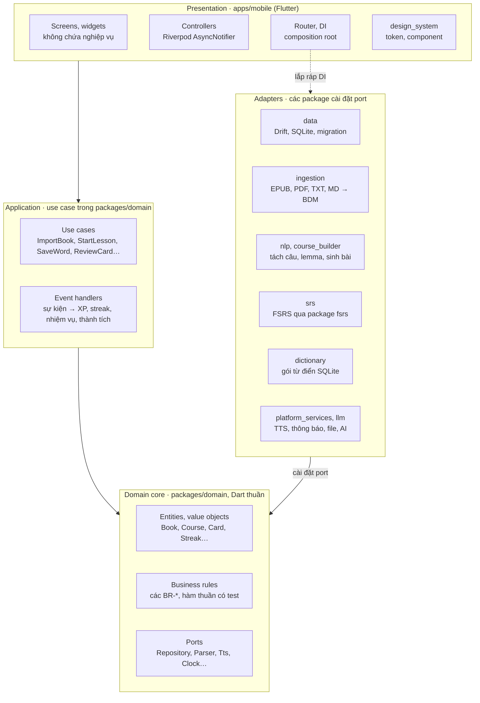
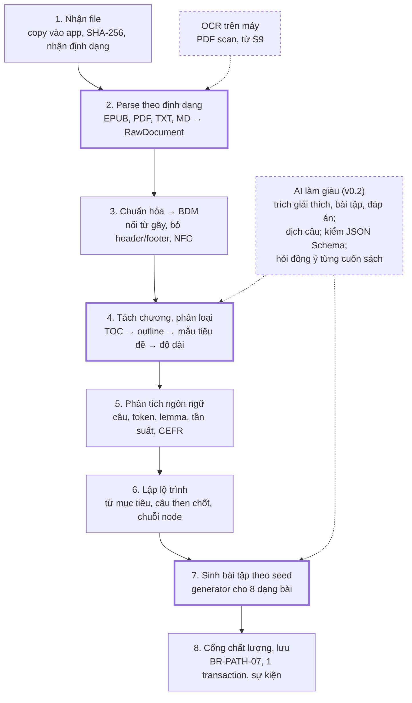

# English101 — Kiến trúc hệ thống

> Phiên bản: 1.0 · Ngày: 2026-09-28 · Tham chiếu: [PRD](../PRD/PRD.md) · [Quy chuẩn code](CODING-STANDARDS.md) · ADR chi tiết đặt trong `docs/spec/adr/`

Clean Architecture trong một monorepo Flutter: lõi nghiệp vụ viết bằng Dart thuần, adapter thay thế được, mọi dữ liệu nằm trên máy người dùng.

---

## 1. Nguyên tắc và quyết định kiến trúc

Kiến trúc tối ưu cho ba điều: chạy offline trên máy người dùng, logic học tập test được mà không cần Flutter, và cộng đồng mở rộng được mà không đụng vào lõi.

1. **Quy tắc phụ thuộc:** phụ thuộc chỉ hướng vào trong; domain là Dart thuần, không biết Flutter, SQLite hay mạng.
2. **Local-first:** SQLite trên máy là nguồn sự thật; mạng chỉ dùng khi người học chủ động.
3. **Lát cắt dọc:** mỗi use case đi xuyên UI → use case → port → adapter, khớp với cách chia sprint.
4. **Ports and adapters:** mọi thứ bên ngoài (DB, file, PDF, TTS, thông báo, LLM, đồng hồ) nằm sau một interface.
5. **Xác định:** Clock và Random được inject; bài tập sinh theo seed; test không chập chờn.
6. **Log chỉ-ghi-thêm:** XP, ví, lượt trả lời, lượt ôn không bao giờ bị sửa; số liệu tổng hợp dựng lại được và dễ đồng bộ về sau.
7. **Mở rộng bằng plugin:** parser, bộ tách chương, generator bài tập, renderer, từ điển, LLM đăng ký qua một registry ở composition root.

| ADR | Quyết định | Lý do chính | Phương án bị loại |
| --- | --- | --- | --- |
| ADR-001 | Flutter + Dart | Một codebase cho Android, iOS, tablet; UI game tùy biến; có pdfrx cho PDF; domain Dart thuần test nhanh | React Native (chọn chữ PDF yếu nếu không trả phí), Kotlin Multiplatform, hai codebase native |
| ADR-002 | Clean Architecture trong monorepo Dart pub workspace + Melos 8 | Quy tắc phụ thuộc được ép bằng pubspec của từng package; contributor làm việc trên package nhỏ | Một package app chia thư mục (quy tắc chỉ là quy ước) |
| ADR-003 | Local-first, SQLite qua Drift | Offline 100%; truy vấn quan hệ type-safe; migration có test | Hive, Isar (NoSQL, truy vấn quan hệ kém) |
| ADR-004 | Riverpod 3 + code generation cho state và DI | Kiểm tra lúc biên dịch, override dễ khi test, không cần service locator | Bloc (nhiều boilerplate với nhóm nhỏ), get_it (ẩn phụ thuộc) |
| ADR-005 | FSRS (package fsrs) sau port SrsScheduler | Dự đoán tốt hơn SM-2; có sẵn cho Dart; tối ưu tham số cá nhân về sau | SM-2 (không cá nhân hóa), Half-Life Regression (cần nhiều dữ liệu) |
| ADR-006 | Trình đọc reflow trước, trang PDF gốc ở v0.2 | Một trải nghiệm cho mọi định dạng; highlight neo trên văn bản chuẩn hóa; giảm rủi ro R1 | Chỉ hiển thị PDF gốc |
| ADR-007 | Sinh bài tập rule-based, xác định; AI chỉ làm giàu ở v0.2, người dùng tự mang key | Offline, miễn phí, tái lập được; AI tùy chọn và luôn qua kiểm tra schema | AI bắt buộc (tốn phí, cần mạng, đưa nội dung sách ra ngoài) |
| ADR-008 | Book Document Model (BDM) chuẩn hóa | Mọi parser đổ về một mô hình: Book → Section → Block → câu → token có offset | Xử lý trực tiếp HTML hoặc PDF gốc ở từng nơi |
| ADR-009 | Gamification qua sự kiện miền | Thêm luật nhiệm vụ, thành tích mà không sửa use case lõi | Gọi trực tiếp từ use case |
| ADR-010 | ID dạng UUIDv7, thời gian lưu UTC, Clock inject | Sẵn sàng đồng bộ; sắp xếp theo thời gian; test được múi giờ | Khóa số tự tăng |
| ADR-011 | go_router với typed routes | Deep link từ thông báo; route kiểm tra lúc biên dịch | Navigator 1.0 |
| ADR-012 | Mã nguồn Apache-2.0, gói dữ liệu cấp phép riêng (chờ chốt Q1) | Tương thích App Store; dữ liệu share-alike được tách riêng | GPL-3.0 |

ADR đầy đủ nằm trong `docs/spec/adr/NNNN-ten-quyet-dinh.md` theo mẫu MADR; mỗi quyết định mới có tầm ảnh hưởng nhiều package phải có ADR trước khi merge.

---

## 2. Sơ đồ Clean Architecture

Bốn tầng, một chiều phụ thuộc: presentation gọi use case, use case dùng entity và port, adapter cài đặt port.



Đường nét đứt là ngoại lệ duy nhất: composition root trong `apps/mobile` biết mọi adapter để lắp ráp chúng vào provider, nhưng màn hình và controller chỉ gọi use case.

- **Presentation** chỉ hiển thị state và chuyển hành động của người dùng thành lời gọi use case.
- **Use case** là một class một việc, một phương thức `call` trả về `Result`; nó mở transaction, gọi rule, ghi log và phát sự kiện.
- **Domain core** chứa entity bất biến, rule thuần hàm và interface (port); không import Flutter, `dart:io` hay thư viện adapter.
- **Adapter** dịch giữa port và thế giới bên ngoài; ném lỗi bên trong được, nhưng phải đổi thành `Failure` trước khi trả về.

---

## 3. Monorepo và module

Repo là một Dart pub workspace gồm 1 app và 11 package; mỗi package khai báo phụ thuộc riêng nên import sai lớp sẽ không biên dịch được. Melos 8 đọc cấu hình từ khóa `melos` trong `pubspec.yaml` gốc và cần Dart SDK ≥ 3.9.

```text
english101/
├── apps/
│   └── mobile/                   # Flutter: presentation + composition root
│       ├── lib/
│       │   ├── main.dart
│       │   ├── bootstrap.dart    # ProviderScope, override adapter, error zone, logging
│       │   ├── app/              # App widget, router, theme
│       │   ├── features/         # onboarding, library, path, lesson, reader, vocabulary,
│       │   │                     # review, habit, rewards, profile, settings
│       │   └── l10n/             # app_vi.arb, app_en.arb
│       ├── test/
│       └── integration_test/     # Patrol E2E
├── packages/
│   ├── domain/                   # Dart thuần: entity, rule, port, use case, sự kiện
│   ├── nlp/                      # Dart thuần: tách câu, token, lemma, tần suất, CEFR
│   ├── course_builder/           # Dart thuần: từ mục tiêu, lập lộ trình, generator bài tập
│   ├── ingestion/                # Dart thuần + pdfrx_engine: parser → Book Document Model
│   ├── srs/                      # Dart thuần: adapter FSRS
│   ├── dictionary/               # Dart thuần: đọc gói từ điển SQLite
│   ├── data/                     # Drift: bảng, DAO, repository, migration
│   ├── platform_services/        # Flutter plugin: TTS, thông báo, file, secure storage, rung
│   ├── llm/                      # (v0.2) adapter Claude, adapter OpenAI-compatible
│   ├── design_system/            # Flutter: token, theme, component, mascot
│   └── test_support/             # chỉ dùng cho test: FakeClock, repo in-memory, fixture
├── tools/
│   ├── dict_builder/             # CLI: dựng gói từ điển từ Wiktextract, WordNet, CEFR-J
│   └── fixtures/                 # sách mẫu phạm vi công cộng cho test
├── docs/                         # PRD/, spec/, spec/adr/
├── .github/                      # workflows/, ISSUE_TEMPLATE/, PULL_REQUEST_TEMPLATE.md, CODEOWNERS
├── pubspec.yaml                  # workspace + cấu hình melos
├── analysis_options.yaml
├── .fvmrc                        # ghim phiên bản Flutter
└── LICENSE, README.md, CONTRIBUTING.md, CODE_OF_CONDUCT.md, SECURITY.md
```

| Package | Loại | Được phụ thuộc vào | Trách nhiệm |
| --- | --- | --- | --- |
| domain | Dart thuần | meta, collection, freezed_annotation | Entity, value object, rule, port, use case, sự kiện miền |
| nlp | Dart thuần | không package nào trong repo | Tách câu, token, lemma, tra tần suất và CEFR |
| course_builder | Dart thuần | domain, nlp | Cài đặt CourseGenerator và các ExerciseGenerator |
| ingestion | Dart thuần | domain, nlp, pdfrx_engine, archive, xml, html, markdown | Cài đặt BookParser, StructureDetector; chuẩn hóa về BDM |
| srs | Dart thuần | domain, fsrs | Cài đặt SrsScheduler |
| dictionary | Dart thuần | domain, sqlite3 | Cài đặt DictionaryRepository |
| data | Dart (Drift) | domain, drift | Cài đặt repository, unit of work, migration |
| platform_services | Flutter | domain, các plugin | Cài đặt TtsService, NotificationScheduler, FileSource, SecretStore, Haptics |
| llm (v0.2) | Dart thuần | domain, http | Cài đặt LlmProvider |
| design_system | Flutter | flutter, rive | Token, theme, component; không biết domain |
| test_support | Dart thuần (dev) | domain | Test double và fixture loader dùng chung |
| apps/mobile | Flutter | mọi package trên | Presentation và composition root |

Ba luật không có ngoại lệ: không package nào phụ thuộc `apps/mobile`; `domain` không phụ thuộc package nào trong repo; `design_system` không phụ thuộc `domain`.

Bên trong `domain`, mỗi bounded context có cùng khuôn thư mục:

```text
packages/domain/lib/
├── domain.dart            # barrel: chỉ export API công khai
└── src/
    ├── core/              # Result, Failure, Clock, IdGenerator, DomainEvent, EventBus, UnitOfWork
    ├── library/           # Book, Section, Block, ImportJob
    ├── course/            # Course, Unit, PathNode, Exercise
    ├── learning/          # LessonSession, Attempt, chấm điểm
    ├── vocabulary/        # VocabEntry, VocabContext, Highlight
    ├── review/            # Card, ReviewLog
    ├── habit/             # LearningDay, DailyActivity, Streak, NotificationPlan
    └── rewards/           # XpLedger, Wallet, Quest, Achievement
        # mỗi context: entities/  rules/  ports/  usecases/  events/
```

Feature trong app cũng cùng một khuôn:

```text
apps/mobile/lib/features/lesson/
├── lesson_providers.dart        # nối use case với controller
├── controllers/lesson_controller.dart
├── screens/lesson_screen.dart
├── widgets/feedback_sheet.dart
└── exercises/                   # mỗi dạng bài một ExerciseRenderer
```

---

## 4. Mô hình miền và dữ liệu

Dữ liệu chia thành 8 aggregate, lưu trong 22 bảng SQLite; 4 bảng là log chỉ-ghi-thêm, các bảng số liệu tổng hợp dựng lại được từ log.

Quy ước chung: khóa chính là UUIDv7 dạng text; thời điểm là epoch mili-giây UTC, kèm `tz_offset_min` khi cần tính ngày học; mọi bảng có `updated_at`; bảng sẽ đồng bộ ở v1.0 dùng xóa mềm bằng `deleted_at`.

| Aggregate | Bảng | Cột chính | Ghi chú |
| --- | --- | --- | --- |
| Book | books | id, title, author, format, file_path, file_hash, cover_path, status | file_hash dùng phát hiện trùng |
| Book | import_jobs | id, book_id, stage, progress, error_code | Máy trạng thái nhập, tiếp tục được |
| Book | sections | id, book_id, parent_id, ord, title, kind, word_count, content_hash | kind: unit, front, back, answer_key, excluded |
| Book | blocks | id, section_id, ord, type, text | Văn bản chuẩn hóa (BDM) |
| Course | courses | id, book_id, level_cefr, generator_version, seed | Mỗi lần sinh lại tạo phiên bản mới |
| Course | units | id, course_id, section_id, ord, title, status | |
| Course | path_nodes | id, unit_id, ord, type, levels_total, levels_done, state | type: lesson, reading, chest, practice, checkpoint |
| Course | exercises | id, node_id, level, ord, type, payload_json, answer_json, source_ref_json, origin | origin: rule, llm, user |
| LessonSession | lesson_sessions | id, node_id, level, started_at, ended_at, result, accuracy, xp, hearts_lost | |
| LessonSession | attempts | id, session_id, exercise_id, answer_json, correct, typo, duration_ms | Chỉ-ghi-thêm |
| VocabEntry | vocab_entries | id, lemma, display, pos, meaning_vi, ipa, cefr, freq_rank, status, source, note | lemma là khóa duy nhất |
| VocabEntry | vocab_contexts | id, entry_id, sentence, book_id, block_id, char_start, char_end | Tối đa 5 mỗi entry |
| VocabEntry | highlights | id, book_id, block_id, char_start, char_end, quote, entry_id | Neo = block + offset + đoạn trích để neo lại sau khi sửa cấu trúc |
| Card | cards | id, entry_id, type, fsrs_state_json, due_at, lapses, suspended | Snapshot trạng thái FSRS (toMap/fromMap) |
| Card | review_logs | id, card_id, rating, reviewed_at, elapsed_ms, state_before_json | Chỉ-ghi-thêm, dùng tối ưu FSRS về sau |
| Habit | daily_activity | learning_day, xp, lessons, reviews, goal_met, streak_counted, frozen | Dẫn xuất từ xp_events |
| Habit | streak_state | current, longest, last_counted_day | 1 dòng, dẫn xuất |
| Rewards | xp_events | id, source, amount, ref_id, learning_day, created_at | Sổ cái XP, chỉ-ghi-thêm |
| Rewards | wallet_events | id, currency, delta, reason, ref_id, created_at | currency: gem, heart, freeze; chỉ-ghi-thêm |
| Rewards | quests | id, learning_day, template, target, progress, reward_gems, status | |
| Rewards | achievements | key, tier, unlocked_at | |
| Settings | settings | key, value_json | Mục tiêu, giờ nhắc, giờ bắt đầu ngày, hạn mức từ mới, kế hoạch Nếu–thì |

Chỉ mục bắt buộc: `cards(due_at, suspended)`, `vocab_entries(lemma)`, `xp_events(learning_day)`, `attempts(session_id)`, `highlights(book_id, block_id)`. Số tim hiện tại được tính khi đọc từ `wallet_events` và thời điểm hồi tim gần nhất, không cần bộ hẹn giờ.

Gói từ điển là một file SQLite riêng, chỉ đọc, tải về một lần: `entries(lemma, pos, ipa, cefr, freq_rank)`, `senses(entry_id, lang, gloss, example)`, `forms(form, lemma)` dùng cho lemma hóa. Gói có manifest ghi phiên bản, nguồn và giấy phép từng nguồn.

---

## 5. Pipeline nhập sách → khóa học

Pipeline có 8 bước, chạy trong isolate nền và ghi trạng thái vào `import_jobs` sau mỗi bước, nên job tiếp tục được khi app bị tắt (BR-IMP-08).



Bước 2, 4, 7 (viền đậm) là nơi cộng đồng thêm parser, bộ tách chương và dạng bài mới (mục 7). OCR và AI (nét đứt) là nhánh tùy chọn, không bước nào của luồng chính phụ thuộc vào chúng.

### Book Document Model (BDM)

- Cấu trúc: Book → Section (cây, có kind) → Block (heading, paragraph, list_item, table_cell, quote) → câu → token.
- Mọi offset tính trên văn bản đã chuẩn hóa NFC; highlight neo theo `(block_id, char_start, char_end)` kèm đoạn trích để neo lại khi nội dung đổi.
- PDF: text lấy từ `loadStructuredText` của `pdfrx_engine` (có toạ độ ký tự, dùng cho bố cục 2 cột ở S9); outline dùng cho tách chương.
- EPUB: parser tự viết bằng `archive` + `xml` + `html` (đọc OPF, spine, nav/NCX); `epubx` 4.0.0 đã 3 năm không cập nhật nên chỉ dùng để tham khảo.

### Phân tích ngôn ngữ

- Tách câu theo luật dấu câu, có danh sách viết tắt (Mr., e.g., U.S.); tách token theo ranh giới từ Unicode, giữ dấu nháy trong từ (don't, it's).
- Lemma: tra bảng `forms` của gói từ điển; không có thì dùng luật hậu tố (-s, -es, -ed, -ing) rồi kiểm ngược trong từ điển.
- Gắn hạng tần suất và CEFR từ gói dữ liệu; loại stop word, số và tên riêng (viết hoa giữa câu, không có trong từ điển).

### Sinh bài tập

- Mỗi generator nhận `TargetItem` (từ hoặc câu), `GenerationContext` (unit, trình độ, từ điển, từ cùng unit) và `Random` có seed (BR-PATH-08).
- Phương án nhiễu: cùng loại từ, hạng tần suất chênh không quá 30%, lấy từ cùng unit trước rồi mới tới cả sách; loại từ cùng synset WordNet với đáp án để không có hai đáp án đúng.
- Nghe và chọn: nhiễu là từ có chính tả gần (Levenshtein 1–2), ví dụ though, through, thought.
- Sắp xếp câu chỉ dùng câu 5–12 token; nghe và gõ lại chỉ dùng câu ≤ 10 token.
- Bài vi phạm BR-PATH-07 bị loại; phiên thiếu câu hợp lệ được bù bằng bài của unit trước (xen kẽ có chủ đích).
- Kết quả của AI (v0.2) đi vào bước 4 và 7 dưới dạng dữ liệu đã kiểm schema, mang `origin = llm`, và người học sửa được.

---

## 6. Luồng runtime

Mọi thay đổi trạng thái đi qua một use case chạy trong một unit of work: use case ghi log, phát sự kiện miền, và các handler chạy đồng bộ trong cùng transaction, nên XP, streak, nhiệm vụ không bao giờ lệch nhau.

### Phiên bài học

1. `LessonController` gọi `StartLessonUseCase`: lấy 12 câu (tối đa 2 thẻ ôn đến hạn + bài của node), tạo `LessonSession`.
2. Mỗi lần KIỂM TRA, `SubmitAnswerUseCase` chạy rule chấm điểm, ghi `Attempt` ngay (NFR-07), trừ tim nếu sai, xếp lại câu sai.
3. `CompleteLessonUseCase` phát `LessonCompleted` và trả về `LessonOutcome` (XP, streak vừa tăng, mục tiêu vừa đạt, nhiệm vụ vừa tăng, thành tích mới); UI dùng outcome này để xếp chuỗi màn thưởng.

### Sự kiện miền

| Sự kiện | Phát khi | Handler | Tác dụng |
| --- | --- | --- | --- |
| LessonCompleted | Kết thúc phiên bài học | AwardXp, SeedCardsFromLesson, UnlockNextNode, ProgressQuests, CheckAchievements | Ghi XP, tạo thẻ cho từ vừa dạy (BR-LES-06), mở node kế |
| CheckpointPassed | Đạt Kiểm tra unit | AwardXp, GrantGems, SkipPreviousNodes | 20 XP, 20 gem, đánh dấu node trước là Đã bỏ qua |
| CardReviewed | Mỗi lượt ôn | AwardXp, RefillHeart, UpdateVocabStatus, ProgressQuests | 1 XP (tối đa 20 mỗi phiên), +1 tim mỗi 10 thẻ, cập nhật trạng thái từ |
| WordSaved | Lưu từ hoặc cụm từ | CreateCards, ProgressQuests, CheckAchievements | Thẻ ở trạng thái Mới, xếp hàng theo hạn mức |
| XpEarned | Mỗi bản ghi XP | UpdateDailyActivity | Phát StreakExtended và DailyGoalReached khi vượt ngưỡng lần đầu trong ngày |
| StreakExtended | Lần đầu đạt 10 XP trong ngày | CancelTodayReminders, CheckAchievements | Hủy nhắc còn lại trong ngày; xét mốc streak |
| DayRolledOver | Lần mở app đầu tiên sau giờ bắt đầu ngày mới | CloseDay, GenerateDailyQuests, RescheduleNotifications | Dùng đóng băng hoặc reset streak; tạo 3 nhiệm vụ; lên lịch 7 ngày |

### Quy tắc thời gian và tác vụ nặng

- Không có tiến trình nền: `EnsureDayClosedUseCase` chạy khi mở app, khi app quay lại foreground và trước mọi sự kiện XP; chạy lại nhiều lần vẫn cho cùng kết quả.
- Ngày học do một hàm thuần duy nhất tính: `LearningDay.of(instantUtc, tzOffset, rolloverHour)`; không code nào khác tự tính "hôm nay".
- Tim được tính khi đọc từ số tim đã lưu và thời điểm hồi gần nhất (4 giờ một tim), không cần hẹn giờ.
- FSRS: `SrsScheduler.review(card, rating, now)` trả trạng thái mới; use case ghi `ReviewLog` và cập nhật snapshot thẻ trong cùng transaction.
- Thông báo: sau mỗi hoạt động và mỗi lần mở app, `NotificationPlanner` tính lại lịch 7 ngày tới theo BR-NTF-01 đến BR-NTF-05 rồi đồng bộ với hệ điều hành.
- Nhập sách và sinh lộ trình chạy trong isolate riêng, gửi tiến độ qua `Stream`; isolate giao diện không đọc file lớn đồng bộ.

---

## 7. Điểm mở rộng cho cộng đồng

Sáu interface dưới đây là nơi contributor thêm tính năng mà không sửa domain; mọi plugin được đăng ký ở composition root.

```dart
// packages/domain — port, Dart thuần
abstract interface class BookParser {
  String get id; // 'epub', 'pdf-text', 'txt', 'md'
  bool canParse(FileSignature signature);
  Future<Result<RawDocument>> parse(ImportSource source, ProgressSink progress);
}

abstract interface class StructureDetector {
  int get priority; // số lớn chạy trước
  SectionTree? detect(BookDocument document); // null = không nhận ra cấu trúc
}

abstract interface class ExerciseGenerator {
  ExerciseType get type;
  Set<LearningStage> get stages; // recognition, recall, production
  bool supports(TargetItem target, GenerationContext context);
  Exercise generate(TargetItem target, GenerationContext context, Random random);
}

abstract interface class DictionaryRepository {
  Future<List<DictionaryEntry>> lookup(String lemma, {PartOfSpeech? pos});
}

abstract interface class SrsScheduler {
  CardState initial(DateTime now);
  ReviewOutcome review(CardState card, Rating rating, DateTime now);
  Map<Rating, Duration> preview(CardState card, DateTime now);
}

abstract interface class LlmProvider {
  String get id; // 'anthropic', 'openai-compatible'
  Future<Result<Map<String, Object?>>> generateJson({
    required String system,
    required String prompt,
    required Map<String, Object?> jsonSchema,
  });
}
```

```dart
// apps/mobile — renderer cho từng dạng bài, và registry ở composition root
abstract interface class ExerciseRenderer {
  ExerciseType get type;
  Widget build(BuildContext context, Exercise exercise, AnswerController answer);
}

final plugins = PluginRegistry()
  ..addParser(EpubParser())
  ..addParser(PdfTextParser())
  ..addDetector(TocDetector())
  ..addDetector(HeadingPatternDetector())
  ..addGenerator(SelectMeaningGenerator())
  ..addRenderer(SelectMeaningView.renderer);
```

Thêm một dạng bài mới gồm 5 bước, mỗi bước có test riêng:

1. Thêm giá trị vào `ExerciseType` và payload (freezed union) trong domain.
2. Viết `ExerciseGenerator` trong `course_builder` kèm test thuộc tính: đáp án hợp lệ, nhiễu khác nhau, cùng seed cho cùng kết quả.
3. Viết `ExerciseRenderer` trong `apps/mobile/lib/features/lesson/exercises` kèm widget test và golden sáng/tối.
4. Đăng ký vào `PluginRegistry`; thêm chuỗi ARB vi và en; thêm nhãn Semantics.
5. Cập nhật snapshot fixture (đã review diff) và mở PR kèm video demo.

Thêm một định dạng sách (ví dụ DOCX) tương tự: cài đặt `BookParser` trong `ingestion`, thêm file mẫu phạm vi công cộng vào `tools/fixtures`, đăng ký vào registry. Gói từ điển cho ngôn ngữ khác chỉ cần build bằng `tools/dict_builder` theo cùng schema.

### Adapter AI (v0.2)

`AnthropicLlmProvider` gọi thẳng Messages API bằng package `http`, vì Anthropic chưa có SDK Dart chính thức; key do người dùng tự nhập.

| Khía cạnh | Quy định |
| --- | --- |
| Endpoint và header | `POST https://api.anthropic.com/v1/messages`; header `x-api-key` (key của người dùng), `anthropic-version: 2023-06-01`, `content-type: application/json` |
| Model | Mặc định `claude-opus-5`; danh sách lấy từ `GET /v1/models`; người dùng tự chọn model khác trong Cài đặt |
| Đầu ra có cấu trúc | `output_config.format = { type: "json_schema", schema }`; mọi object có `additionalProperties: false`; schema không đệ quy, không dùng `minLength` hoặc `minimum` (API không hỗ trợ) nên các ràng buộc đó kiểm lại ở client |
| Output dài | `stream: true` với `max_tokens` 64000; `stop_reason = max_tokens` thì chia nhỏ unit và chạy lại |
| Từ chối | `stop_reason = refusal` thì output có thể không khớp schema; lời gọi đồng bộ bật server-side fallback (`fallbacks: "default"`, beta `server-side-fallback-2026-07-01`) |
| Prompt caching | System prompt, schema và bối cảnh sách đặt trước với `cache_control: {type: "ephemeral"}`; nội dung unit đặt sau; kiểm `usage.cache_read_input_tokens > 0` (prefix tối thiểu 512 token trên Claude Opus 5) |
| Cả cuốn sách | Message Batches API (`POST /v1/messages/batches`) giảm 50% chi phí, kết quả về trong tối đa 24 giờ; batch không nhận tham số `fallbacks` nên mục bị từ chối được chạy lại riêng |
| Trước khi chạy | Đếm token bằng `POST /v1/messages/count_tokens`, hiện chi phí ước tính và xin đồng ý gửi nội dung cuốn sách đó |
| Lỗi mạng | 429 và 5xx thử lại theo `retry-after` với backoff; job AI lưu trạng thái theo từng unit để app bị tắt vẫn tiếp tục được |
| Bảo mật key | Chỉ lưu trong Keystore/Keychain qua `SecretStore`; không log; không bao giờ nhúng key của dự án vào bản build |

Ước tính thô với bảng giá hiện tại của Claude Opus 5 (5 USD/1 triệu token vào, 25 USD/1 triệu token ra): một cuốn 300 trang tốn khoảng 1–3 USD, khoảng một nửa nếu dùng Batches; con số thật lấy từ `count_tokens`. Adapter thứ hai theo chuẩn OpenAI-compatible (Ollama, LM Studio) dành cho model chạy local do cộng đồng đóng góp.

---

## 8. Tech stack

Stack giữ đúng khuyến nghị của file nghiên cứu (Flutter + Drift + FSRS + pdfrx + TTS + thông báo cục bộ), bổ sung monorepo, state, test và AI. Phiên bản ghi trong bảng đã kiểm trên pub.dev ngày 28/09/2026; thư viện còn lại ghim phiên bản ở S0 và kiểm giấy phép bằng script.

### Lõi

| Hạng mục | Thư viện | Vai trò | Giấy phép | Đã kiểm |
| --- | --- | --- | --- | --- |
| Ngôn ngữ, UI | Flutter stable, Dart ≥ 3.9 (ghim bằng FVM) | UI đa nền tảng | BSD-3 | — |
| Monorepo | Dart pub workspaces + [Melos](https://pub.dev/packages/melos) | Quản lý package, script | Apache-2.0 | 8.9.0 |
| State, DI | [flutter_riverpod](https://pub.dev/packages/flutter_riverpod) + riverpod_generator | Controller, provider, override khi test | MIT | 3.4.3 |
| Cơ sở dữ liệu | [drift](https://pub.dev/packages/drift), drift_flutter, sqlite3 | SQLite type-safe, migration | MIT | 2.35.0 |
| SRS | [fsrs](https://pub.dev/packages/fsrs) | Scheduler, Card, Rating, ReviewLog | MIT | 2.0.1 |
| PDF | [pdfrx](https://pub.dev/packages/pdfrx) / pdfrx_engine | `loadText`, `loadStructuredText`, outline, render trang | MIT | 2.6.5 |
| EPUB | archive, xml, html (parser tự viết) | Giải nén, đọc OPF, nav, XHTML | MIT, BSD-3 | [epubx](https://pub.dev/packages/epubx) 4.0.0 chỉ tham khảo |
| Kiểm thử E2E | [patrol](https://pub.dev/packages/patrol) | Test có thao tác native (quyền, thông báo) | Apache-2.0 | 4.10.0 |

### Hỗ trợ

| Hạng mục | Thư viện | Vai trò | Giấy phép |
| --- | --- | --- | --- |
| Điều hướng | go_router, go_router_builder | Typed routes, deep link | BSD-3 |
| Mô hình bất biến | freezed, json_serializable | Entity, union, JSON | MIT, BSD-3 |
| Markdown | markdown | Parse file MD | BSD-3 |
| TTS | flutter_tts | Đọc từ và câu bằng giọng của hệ điều hành | MIT |
| Thông báo | flutter_local_notifications, timezone | Nhắc nhở cục bộ | BSD-3 |
| File, bí mật | file_picker, flutter_secure_storage | Chọn file, lưu API key | MIT, BSD-3 |
| OCR (S9) | google_mlkit_text_recognition hoặc Tesseract | Nhận dạng chữ trên máy; chốt ở spike S9 | Plugin MIT; ML Kit là SDK đóng của Google |
| Hoạt ảnh, âm thanh | rive, audioplayers | Mascot, hiệu ứng | MIT |
| Tiện ích | uuid (v7), logging, intl | ID, log, định dạng theo locale | MIT, BSD-3 |
| Kiểm thử | test, flutter_test, mocktail, alchemist | Unit, widget, golden | BSD-3, MIT |
| Lint | very_good_analysis, riverpod_lint | Quy tắc tĩnh | MIT |
| CI/CD | GitHub Actions; Codemagic cho iOS khi cần | Build, test, phát hành | — |
| AI (v0.2) | http + Claude Messages API | Adapter LlmProvider | BSD-3 |

---

## 9. Bảo mật, quyền riêng tư và hiệu năng

Dữ liệu không rời máy nếu người học không chủ động; mọi file người dùng đưa vào được coi là không tin cậy và xử lý trong isolate có giới hạn.

### Quyền riêng tư

- Không tài khoản, không analytics ở v0.1; báo crash là opt-in (Q9).
- Gọi mạng chỉ khi người học bấm: tải gói từ điển, chạy AI với key của họ (v0.2), gửi báo lỗi.
- AI xin đồng ý riêng cho từng cuốn sách và hiện rõ phần nào của sách sẽ được gửi đi.
- Log chỉ ghi id và độ dài, không ghi nội dung sách, từ đã lưu hay API key.

### Bảo mật

- API key nằm trong Android Keystore / iOS Keychain qua `flutter_secure_storage`; không bao giờ vào SQLite, file sao lưu hay log.
- EPUB là file zip: giới hạn tổng dung lượng giải nén 500 MB và 10.000 mục để chặn zip bomb; không phân giải entity ngoài khi đọc XML (chặn XXE); bỏ qua script trong XHTML.
- Parser chạy trong isolate có timeout; lỗi parser chỉ làm hỏng job nhập, không làm sập app.
- Quyền Android tối thiểu: chọn file qua Storage Access Framework (không xin quyền bộ nhớ rộng), `POST_NOTIFICATIONS` trên Android 13+, `INTERNET`; không xin `SCHEDULE_EXACT_ALARM`.
- File sao lưu mặc định không mã hóa và có cảnh báo khi chia sẻ; mã hóa bằng mật khẩu ở v0.2.

### Hiệu năng

- Mọi việc nặng (nhập sách, sinh lộ trình, OCR) chạy trong isolate; UI chỉ nhận tiến độ.
- Khởi động nhanh: mở gói từ điển lười khi cần tra lần đầu, tải trước Rive và âm thanh sau frame đầu tiên.
- Lộ trình: vị trí node tính trước một lần khi sinh khóa học; danh sách dùng builder lazy.
- Chỉ mục DB theo mục 4; truy vấn thẻ đến hạn ≤ 30 ms với 10.000 thẻ (đo ở S6).
- Ngân sách hiệu năng theo NFR-02 đến NFR-06, đo bằng benchmark và trace mỗi sprint.

---

## 10. Chiến lược kiểm thử

Phần lớn test chạy trên Dart thuần, không cần emulator, nên CI cho PR dưới 10 phút; E2E chạy mỗi đêm và trước mỗi bản phát hành.

| Tầng | Công cụ | Phạm vi | Ngưỡng |
| --- | --- | --- | --- |
| Unit | package:test | domain, nlp, course_builder, srs, ingestion | domain ≥ 90% dòng; mỗi BR có ít nhất 1 test mang mã BR |
| Snapshot | test + JSON trong tools/fixtures | Output của parser và generator trên sách mẫu, seed cố định | Mọi thay đổi output phải review diff trong PR |
| Dữ liệu | Drift in-memory, test schema của drift_dev | Repository, unit of work, migration | 100% phiên bản schema có test migration |
| Widget, golden | flutter_test, alchemist | design_system và màn hình | Golden sáng/tối, cỡ chữ 1,0 và 2,0 |
| Accessibility | meetsGuideline: vùng chạm, tương phản, nhãn | Mọi màn hình mới | 0 vi phạm |
| E2E | Patrol trên emulator Android | 5 flow: onboarding; nhập sách → bài 1; đọc, lưu từ → ôn; streak qua ngày với FakeClock; sao lưu → khôi phục | Xanh trước mỗi release |
| Hiệu năng | Benchmark Dart, integration test có trace | Nhập sách, sinh lộ trình, tra từ, cuộn lộ trình | Theo NFR-02 đến NFR-05 |
| Thủ công | Checklist khám phá, tự dùng hằng ngày từ S3 | Mỗi sprint | Mọi lỗi thành issue có nhãn |

Test double dùng chung trong package `test_support`: `FakeClock` (tua thời gian, đổi múi giờ), `SeededRandom`, repository in-memory, `FakeTts`, `FakeNotificationScheduler`, `FakeLlmProvider`. Fixture chỉ dùng sách phạm vi công cộng hoặc tự viết: 1 EPUB, 1 TXT, 1 MD, 1 PDF có outline, 1 PDF hai cột và 1 PDF scan (S9).
